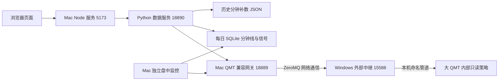

# A股/转债实时板块表


一个以 A 股和可转债为中心的本地研究工作台，包含行情看板、盘中监控、历史图表、量化回测、模拟盘、AI 分析和受控手工交易。界面按短线板块池风格设计：小卡片、高密度、红涨绿跌，适合快速扫板块强弱和转债活跃度。


## 当前架构与最近改动

以下按 **2026-11-01 本机工作区和部署记录**整理。本机仍有未提交改动，本文描述不等同于 GitHub `main` 已发布版本。

简单说：**Mac 负责网页、数据整理、指标和研究；Windows QMT 负责提供券商行情。** 前端使用原生 HTML/CSS/JavaScript，后端由 Node 和 Python 多个进程协作，数据分别保存为 SQLite 和 JSON。



图中 Windows 是 Parallels 的 Windows 11，部署地址为 `10.211.55.3`。Mac 网关和 Python 数据服务监听本机回环地址。接口名中的 `/api/miniqmt/*` 是保留的兼容名称，行情与历史数据仅使用大 QMT。MiniQMT 已停用，后端、自动回退与昨收交叉查询均已移除；账户与交易路由为 `disabled`，大 QMT 下单与撤单关闭。

### 最近主要改了什么

- **升级通信组件**：大 QMT 兼容库从旧版升级到 `xtquant-big-convert 0.3.74`，保留原有看板接口。
- **适应 QMT 的文件与网络限制**：把通信策略所需代码合成一个 Python 文件，QMT 内通过本机管道交给 Windows 外部中继，再由中继与 Mac 通信。
- **修复监控启动超时**：证券资料查询从大批量读取逐步缩小到每次一只，避免请求累积超时导致监控退出。10 月 28 日验证过分钟与事件持续落库，10 月 30 日进一步调整并恢复启动。
- **修正昨收与涨跌幅**：根据每只证券的行情日期读取前一有效交易日收盘价，避免旧昨收字段及周末日期切换导致涨跌幅算错。
- **改善连接恢复**：网关记录超时与故障，并在 RPC 超时后释放旧连接供后续请求重新建立连接；失败时不会切到其他 QMT 服务。大 QMT 下单和撤单保持关闭。

**2026-11-01 首次排查记录**：本机页面服务可达，但代表报价请求返回 503，网关记录大 QMT 超时和旧 MiniQMT 上游错误。此前 10 月 27 日的管道验收与后续盘中监控恢复记录不能代替当日检查；本次恢复结果见下文，也不代表历史数据已全部补齐。

**2026-11-01 20:43 后恢复记录**：确认 Windows 外部中继未运行、15588 未监听后，使用原配置启动中继。大 QMT 应答恢复，网页报价、60 根日 K 和短范围分钟 K 均返回 200，数据截至最近交易日 10 月 30 日。这是当时的抽样恢复记录；本地旧日线库未因此自动更新。Windows 中继目录新增 `start-relay.cmd`，可双击启动，已有中继时不会重复创建进程。

**2026-11-01 退役 MiniQMT**：网页统一使用 QMT 标识，运行配置固定大 QMT；独立监控的默认地址也改到本机 18889，旧配置不会重新启用 MiniQMT。日 K 加载失败时清除旧分时图，缺失的溢价率／市值显示缺失，休市提示改为最近可用交易日。约 20:54 再查发现：外部中继仍在，但 QMT 内部管道不存在；中继端口正常不代表数据策略仍在运行。随后用户在模型交易中启动已有只读策略，21:06 后重新验收通过：健康应答、报价、日线与分钟线均可读取；万凯转债网页实际绘制 120 根日 K（2026-05-07 至 2026-10-30），五档恢复。首页、状态与指数接口均为 200。当前只确认这些抽样请求与页面恢复，不表示全市场历史覆盖或持续运行已经验收。

### Windows 通信策略来自哪里

核心来自开源项目 [xtquant_big_convert](https://github.com/litaolemo/xtquant_big_convert)。本项目使用其 `0.3.74` 包和上游命名管道单文件构建器，生成 QMT 中的 `FINANCE_BIGQMT_READONLY_PIPE` 策略。

策略内部包含启动配置、QMT 回调、管道收发、请求分发、行情与账户接口适配、结果转换等代码。所需模块嵌入同一个文件，在内存中加载；本项目补充了账户与管道配置，并修补 QMT 注入函数的绑定，使历史下载等函数能被内部模块调用。下单相关模块虽随库打包，但当前配置关闭远程下单与撤单，外部中继也拒绝转发这些方法。

Windows 外部中继部署在 `C:\Users\seasnake\finance-qmt-pipe\`；QMT 内部策略负责本机管道，外部中继负责 `15588` 网络端口。当前主链路不依赖 Redis，行情由上层主动查询。

- [本项目策略构建与配置](scripts/prepare_bigqmt_pipe_bundle.py)
- [Windows 管道与网络中继](scripts/qmt_pipe_zmq_relay.py)
- [Mac 网关实际接口与参数映射](scripts/qmt_compat_gateway.py)
- [迁移及验收记录](docs/architecture/qmt-migration.md)：包含早期方案；当前部署以 10 月 27 日单文件管道方案及之后的恢复记录为准。

### 如何操作虚拟机里的 QMT

已验收的图形操作路径是：**Mac CLI → Parallels Windows 11 内的 Codex → Windows 自己的 computer use → QMT**。2026-10-27，Windows Codex 通过这条路径成功导入并启动 `FINANCE_BIGQMT_READONLY_PIPE`，随后验证了中继、RPC、报价、日 K 与分钟 K。

需要操作 QMT 界面时，优先复用这条路径：

1. 通过 `prlctl exec 'Windows 11' --current-user ...` 调用虚拟机内当前用户的 Windows 命令，核对登录身份与桌面会话。不带 `--current-user` 的调用曾进入 SYSTEM / session 0。
2. 从运行中的 Codex 进程取得当前 `codex.exe` 路径，再通过 CLI 调起带有 Windows computer use 工具的既有 Windows 会话。自动更新会改变可执行文件目录，不固定使用旧版本路径。
3. 由 Windows Codex 按“我的 → 策略列表最后的 `FINANCE_BIGQMT_READONLY_PIPE` → 编辑 → 日志输出”检查运行状态。相隔至少 10–12 秒观察日志时间戳和 `adjust` 定时计数是否持续更新，再由 Mac 复核 RPC 与数据。不能仅凭模型交易表的播放三角或“执行中策略 0”判断停止。用户已授权且确认停止时才在编辑器点一次“运行”，运行中不重复启动。启动脚本仅作参考，需按本轮目标适配，不能原样重跑旧部署、重复导入策略或恢复已停用的 MiniQMT。

**2026-11-01 分两轮核验**：早先失败的是 Mac 侧 computer use 操作虚拟机窗口，另一次 `prlctl capture` 得到黑屏；当轮未调用 Windows Codex，最终由用户启动已有只读策略后恢复数据，策略此前为何停止尚未查明。

**23:34 Windows Codex 实测通过**：通过当前用户的 CLI 调起 Windows Codex，使用其 `mcp__node_repl__js` + `@oai/sky` 获取真实截图，完成“模型交易 → 行情 → 模型交易”的往返切换，并查看已有策略行。未启停、导入或修改策略，未执行交易。Mac 端随后复核健康、报价、日 K 和分钟 K 均正常。模型交易行显示播放三角，未从该 UI 确认此实例正在运行；这与数据链路正常分别记录，没有为验证而重复启动。4 张脱敏截图、报告及检查结果保存在 `runtime/qmt-migration/windows-codex-cua-20261101/`。

**23:42 补齐运行状态验证**：Windows Codex 直接查看已打开的 PIPE 策略编辑器，日志从 23:42:26.321 更新到 23:42:36.419，每 10 秒均有 101 次定时回调，确认策略正在运行。23:43:18 Mac 健康、报价、日 K 和分钟 K 均通过；未点击运行或启停策略。先前“未确认运行”是检查入口不完整，现已补齐。截图与报告保存在 `runtime/qmt-migration/windows-codex-strategy-state-20261101/`。

本机维护规程见 [qmt-bridge-pd 技能](/Users/seasnake/.codex/skills/qmt-bridge-pd/SKILL.md)及其[Windows Codex 操作参考](/Users/seasnake/.codex/skills/qmt-bridge-pd/references/bigqmt-finance.md)。这些技能位于本机仓库之外。历史启动脚本和验收结果保存在忽略提交的 `runtime/qmt-migration/upgrade-20261027/`，不是克隆仓库后自动可用的运行环境。

### 通信接口怎么查

看板的数据服务和监控通过 **HTTP + JSON** 调用 `http://127.0.0.1:18889`。网关沿用 QMT Bridge 接口约定，再将已适配的方法转换为大 QMT 的远程调用。`15588` 是 ZeroMQ 端口，不是 HTTP 地址。

| 方法与路径 | 用途 |
| --- | --- |
| `GET /api/meta/qmt-backends` | 查询行情源、交易源及最近错误；`active` 字段不能单独证明最新行情成功 |
| `GET /api/meta/health` | 查询后端健康 |
| `GET /api/cb/list` | 读取转债列表 |
| `GET /api/market/full_tick` | 最新行情和盘口，参数 `stocks` |
| `GET /api/market/market_data_ex` | K 线，参数含 `stocks`、`period`、`start_time`、`end_time`、`count`、`dividend_type`、`fill_data` |
| `GET /api/instrument/detail_list` | 证券资料，参数 `stocks` |
| `GET /api/calendar/is_trading_date` | 交易日判断，参数 `market`、`date` |
| `POST /api/download/history_data2` | 下载历史行情到 QMT 缓存；上层维护任务再回读、验证和保存 |

完整 QMT Bridge 文档的接口范围大于当前大 QMT 网关适配范围，具体支持以 [网关实现](scripts/qmt_compat_gateway.py) 为准。账户和交易请求使用独立交易路由。通达信另走 Windows 本机 `17709` 的 TQ 服务，见 [通达信选股导入](docs/runbooks/tdx-selection-import.md)。

Skill 和 Codex 定时任务位于这些服务之上，按任务调用脚本、CLI 与 API；页面日常刷新直接调用服务。完整功能、定时任务与存储说明见 [项目总览](docs/architecture/project-overview-2026-11-01.md)，工具及组件版本见 [Skill 与开源组件清单](docs/architecture/skills-and-open-source-2026-11-01.md)。

## 功能

- 实时显示 A 股、ETF、港股和可转债行情。
- 顶部 QMT 图标显示大 QMT 连接状态；不再提供 MiniQMT 或自动回退选项。
- 刷新网页先展示 `runtime/board-quote-snapshot.json` 保存的最近有效报价，并显示缓存数据日期；交易时段后台更新，休市且缓存完整、最近 15 分钟内成功获取时复用缓存。顶部刷新按钮仍可强制更新。部分请求失败会保留旧报价并标记缓存，过期响应不会覆盖更新的交易日。
- 大 QMT 日线昨收修复按每只证券的报价日期取前一交易日收盘，周末保留最近交易日原有涨跌幅；可选接口未适配不会将整条行情连接标为失败。
- 支持板块、叠组、个股/转债的增删改和拖拽排序。
- 叠组可以把多个二级细分板块像卡牌一样收纳，多个分组可同时展开。
- 涨跌幅格子按方向和幅度显示红绿条，超过阈值才强化标红/标绿。
- 顶部显示主要指数：上证指数、创业板指、科创综指、中证转债、韩国 KOSPI、日经 225、恒生科技；“外围分时”与主力监控精灵左右排列，展示纳指100代理、韩国 KOSPI、布油和美国10年期国债收益率。
- “K线”开关可显示或隐藏每只标的的今日分时缩略走势。
- “转债星图”可按申万一至三级行业、主线题材或统一标签展示全部转债；标签分组优先使用人工主标签，未设置时优先采用题材标签，确保每只转债只出现一次。面积可切换成交额/发行规模，色彩可切换涨跌幅/转股溢价率/价格，并可用 QMT 网关行情更新盘中价格、涨跌幅和成交额。小格会按可用空间缩写简称，悬浮分组标题可查看完整转债列表和今日分时缩略线。
- “次新债表现”按最近 1、2、6 个月上市窗口筛选已上市超过 3 天的转债。15、30、60 分钟档从 QMT 1 分钟缓存聚合各桶最后收盘；日线档读取 QMT `1d` 缓存并直接连接每日 `close`。纵轴默认显示实际价格，也可切换为以首个有效取样收盘归一的收益率；曲线可在单调平滑和真实点直连之间切换，平滑只改变连线外观，不修改收盘点、悬浮读数或缺失区间。首尾对齐后按实际日历进程拉伸，悬浮名单按当前位置的价格或收益率动态降序排列。
- “活跃转债指数”是盘中监控页：显示复刻指数分时、日K、成交额和成分宽度，并实时列出成分债的涨跌幅、现价、估算量比、1分钟涨速、成交额、1分钟金额和3日涨跌。复刻指数由既定成分等权合成，明确区别于通达信官方实时指数。
- “实盘”页面保留账户查询、持仓/委托/成交展示和受控手工交易代码，但**当前账户与交易路由已停用**，页面不能查询账户或解锁下单。代码中的交易校验、预览和确认机制不代表该功能当前可用；重新接入须另行授权和验收。
- “量化实验室”以可转债日内事件为主：09:25竞价只定开盘状态，紫线/分时均价形成 Setup，主力资金、动量和量能跨类别确认后按下一分钟成交；止损取盘中结构低点，1R/2R分步止盈，四分之一凯利只负责风险预算并受单笔风险与总仓位双上限约束。日内回放和本地模拟盘均不连接真实账户，也不会调用真实下单或撤单接口。
- 单债详情支持“分时 / 日K”切换；正股名称、代码、现价、涨跌幅和日内缩略图合并在同一卡片，切换视图时保持固定尺寸。日K可查看近60、120或250个交易日的转债蜡烛图、MA5/MA10/MA20和成交额，双击某根K线可按日期读取本地监控及 QMT 历史分钟数据，切换到当日历史分时。日K使用固定周期槽位，新上市转债保持与其他转债一致的K线间距和宽度，缺少的交易日保留为右侧空白。
- 搜索和添加标的优先走本地沪深 A 股名单，远程联想只作兜底。
- 当前板块、叠组和标的池保存到 `data/board-state.json`，不同浏览器打开时使用同一份默认数据。

## 快速启动

迁移到 Windows 单机运行，使用 [Windows 部署与迁移说明](docs/runbooks/windows-migration.md)。部署包包含本地源码、独立监控程序及 QMT 只读策略，历史数据另行备份；Windows 启动入口负责设置本机路径与端口。源码中的 `/api/miniqmt/*` 名称继续沿用。

以下命令启动本地页面服务。完整行情还依赖已配置的 Mac QMT 网关、Windows QMT 策略与中继，以及仓库外的监控程序；仅克隆本仓库不能复原这些运行环境。访问回环服务时，`NO_PROXY` 和 `no_proxy` 应包含 `127.0.0.1,localhost,::1`。

```bash
npm start
```

打开：

```text
http://localhost:5173
```

更新本地沪深 A 股联想名单：

```bash
npm run update:stocks
```

使用通达信本地 `.day` 文件重新生成活跃转债指数研究快照：

```bash
npm run build:active-bond-index -- \
  --index /path/to/sh880677.day \
  --bonds-dir /path/to/cb_day_files \
  --names /path/to/cb_details_or_name_summary.json \
  --output data/active-convertible-bond-index.json
```

通达信 TQ 中已有的条件选股公式可直接生成项目快照，并在“公式选股”页面查看：

```bash
npm run run:tdx-formulas
```

当前默认在通达信“可转债”分类中运行 `单针`、`异动`、`ZX`，结果保存在未跟踪的 `runtime/` 目录。详细说明见 [通达信公式选股结果看板](docs/runbooks/tdx-formula-selection.md)。

生成器会用 880677 当日成交额审计本地转债历史是否完整；未通过审计的日期不会混入复刻统计。

## 可转债标签

普通上市可转债使用统一标签库，实际覆盖随债池、上市资料与人工维护更新，标签会显示在主力监控、活跃转债指数成分表和个债分时页，并可在“转债星图”按标签筛选。

```bash
npm run build:bond-tags -- --as-of 2026-07-31
```

- `data/convertible-bond-tag-source.json`：从“当前上市可转债完整名单与题材分类”工作簿抽取的名单、申万行业和 F10 题材底稿。
- `data/convertible-bond-tags.json`：生成后的统一标签库。
- `data/convertible-bond-tag-overrides.json`：人工增删标签和页面新增的自定义标签，键使用带市场后缀的转债代码。
- “次新债”按上市未满 365 天；“小盘”按正股实时流通市值低于 50 亿元；“光伏”和“核电”只纳入具有直接产品、运营资产或核级供货关系的转债。
- `bond-tags.html` 可筛选、批量移除、设置主标签和新增自定义标签；自定义标签在重建标签库后仍会保留。
- 本地接口 `/api/miniqmt/tags` 支持 `code` 或 `tag` 查询。

## 转债 AI 分析

从主看板“转债 AI 分析”或个债页“AI 分析”进入 `bond-ai.html`。读取日 K、前五日/十日均线和高低参考位、最近 1–5 日分时、现有紫线及可用条款后，点击生成报告。支持关注点、取消、历史快照、完整输入核对与 Markdown 下载。

这一版参考 Tick Stock Panel 的分析任务流程，以预言家文章/课程和可转债 skill 的已核对摘要作为解释框架。复用本机 Codex 登录，默认模型 `gpt-6-astra`，推理强度为高（`high`）；可用 `CB_AI_MODEL`、`CB_AI_REASONING_EFFORT`、`CB_AI_CODEX_PATH` 调整服务配置。模型只接收本次文本快照，报告保存在未跟踪的 `runtime/cb-ai/`，不连接交易操作。

读取已有本地行情，并调用现有个债资料接口补充同日正股报价/分时、强赎记录及公告正文。历史分析按日期筛选公告；转股价单独记录公告日与生效日，已公告强赎时在页面与报告顶部突出执行日期。当前余额观察不冒充历史余额。监控停止时仍可分析历史，旧基础条款、接口失败、分钟缺口和聚合日线会明确标记。实现与来源见 [可转债 AI 分析](docs/architecture/cb-ai-analysis.md)，专项检查：`node --test tests/test_cb_ai.js` 与 `python3 -m unittest discover -s tests -p 'test_cb_ai*.py'`。

## 编辑方式

点击页面右上角的“编辑”后，可以直接在界面上维护板块和标的：

- 板块标题旁的 `+` 可以按名称或代码联想添加股票、ETF、港股或可转债。
- 板块和叠组支持拖拽，也可以用置顶/置底按钮快速移动。
- 个股和转债支持拖拽排序、删除。
- 叠组内的小板块可独立折叠/展开，也能调整顺序。

批量编辑时支持下面的格式：

```text
板块|名称|代码
光模块|中际旭创|300308
白酒|贵州茅台
可转债|韦尔转债|113616
港股|腾讯控股|00700
ETF|科创50ETF|588000
```

省略代码时会用名称自动查询。常见代码格式如 `600519`、`sh600519`、`sz000001`、`113616`、`00700` 也能识别。

## 数据来源

前端只访问本地 Node 服务，由后端统一代理外部行情接口：

- `/api/miniqmt/quotes`：主看板板块内的 A 股、ETF、可转债价格和涨跌幅统一经 QMT 网关读取 `full_tick` 实时行情；单只缺失时显示 `--`，不混入外部行情。
- `/api/miniqmt/daily`：普通查询读取 QMT 日线缓存并合并当日行情，结果在 Python 内存缓存约 5 分钟；`reference=1` 返回本地监控分钟聚合的参考日线。量化流程按日期合并两类结果补缺，普通查询本身不触发历史下载。
- `/api/cb-quant/backtest`：保留 MA20、日线 MACD、EMA5/20、日线紫线、布林和唐奇安六个原有策略，支持单策略回测和统一口径对比；最近交易日日K缺失时自动尝试分钟补数后聚合。
- `/api/cb-quant/strategies`、`/api/cb-quant/replay`：在原有日线功能之外增加日内组合策略，拼接 09:25 竞价债股配对、分钟指标和主力监控事件做单日可审计回放；分钟数据不完整时自动提交维护补数任务并重读，触发后按下一分钟成交。
- `/api/cb-quant/paper`：读取本地纸面账户；模拟盘可选择原有日线策略或日内组合策略，`reset/start/stop/cycle/order` 子接口只允许本机同源页面修改模拟状态。状态保存在未跟踪的 `runtime/cb-paper-account.json`，与 QMT 实盘账户完全隔离。
- `/api/miniqmt/intraday-backfill`：分时“立即刷新”、量化回放和盘后自动修复共用的单标的维护队列。下载先确认监控进程停止，工作日午休或 15:12～18:00 可执行，周末允许人工维护任务；自动全市场任务仍受工作日窗口限制。人工任务优先，连续故障会冷却，不修改历史信号库。独立监控另有自己的后台分钟修复流程，不能把这套维护队列的限制套到所有补数动作上。
- `/api/miniqmt/new-bond-performance`：读取动态上市资料，按 1、2、6 个月窗口返回最多 12 只所选次新债的 15/30/60 分钟或日线收盘连线。分钟档只读 QMT 1 分钟缓存，日线档只读 QMT `1d` 缓存；返回实际首尾日期时间、有效交易日与对应粒度的首日覆盖状态。
- `/api/auction/series`：服务端在 09:15–09:25:30 每 3 秒采集当前看板沪深标的的 QMT 竞价快照，保存竞价价格、累计金额与增量金额；网页首次读取历史，后续按 cursor 增量更新。
- `/api/auction/signals`：在上述竞价快照上按转债—正股配对计算“正股领先、转债放量、联动确认”等只读异动信号，并返回覆盖率与采样状态。
- `/api/quotes`：新浪行情兜底，并继续负责当前 QMT 路径未覆盖的港股等标的。
- `/api/indices`：国内和外围指数报价；上证、创业板、科创综指优先读取 QMT，缺失时用新浪补充，中证转债来自腾讯报价，韩国 KOSPI / 日经 225 / 恒生科技使用对应外围指数源。
- “外围分时”显示四张卡片：纳指100 CFD（`CAPITALCOM:NAS100`，NQ 方向代理）、韩国 KOSPI（新浪报价 / Yahoo 分时）、布伦特原油（TradingView `TVC:UKOIL`，美元/桶）和美国10年期国债收益率（TradingView `TVC:US10Y`）。美债使用 `/api/us10y`，由 `lib/us10y-feed.js` 请求社区使用的非官方 scanner 接口，无需账号或 API Key；报价单位为 `%`（三位小数），`change_abs` 为百分点，乘以100显示 `bp`，昨收由同源报价和变化推算。前端每30秒刷新、服务端缓存20秒，不受 A 股休市暂停影响。源时间来自 `last-price-update-time`（当前返回分钟精度），与成功获取时间分别显示；缺失时标为未知，超过15分钟时提示距今时长。请求最多两次、每次4.5秒，拒绝访问/限流不重试；失败保留上次有效报价和原时间，恢复后继续更新。
- `/api/sparks`：主看板板块内的今日分时缩略走势使用 QMT 1 分钟缓存与现有 `full_tick` 实时采样合并；盘后维护队列会把看板内缺失的沪深股票按单代码、单交易日串行补齐到持久化分钟缓存，不再为板块标的请求腾讯、东方财富或新浪分时。
- `/api/new-bond-second-day`：读取“上市第二交易日”候选，并在开盘前自动把候选幂等加入 `小热次` 板块。上市资料来自动态可转债列表，交易日来自 QMT Bridge 日历，实时价格来自 QMT 网关；因此 QMT 债券列表短暂滞后时，仍能发现新上市沪市转债。目标板块可通过 `NEW_BOND_SECOND_DAY_TARGET_SECTOR` 修改，POST 仅允许本机调用。
- `/api/search`：添加标的联想，本地沪深名单优先，东方财富远程搜索兜底。
- `/api/state`：读取和保存 `data/board-state.json`。

集合竞价期间，卡片缩略图会切换为 QMT 竞价价格线和金额柱；09:25:30 后冻结到 09:30，随后恢复普通盘中分时缩略图。最新竞价采样写入 `runtime/auction-series.json`，并按交易日归档到 `runtime/auction-series-history/YYYYMMDD.json`；均不纳入 Git。

顶部指数 K 线的当前顺序：

- A 股指数：腾讯分时 -> 新浪 5 分钟 K 线。
- 中证转债：腾讯分时。
- 恒生科技：腾讯分时 -> Yahoo 分时。
- 韩国 KOSPI / 日经 225：Yahoo 分时 -> 东方财富分时。
- 纳指100 / 布油 TradingView 图：Capital.com NAS100 CFD / TVC UKOIL；美债社区 scanner 只提供快照，卡片曲线是本站成功请求积累的“本次采样”，非全天历史分时；源报价过旧不追加采样，超过90秒的采样缺口断开绘制。采样保存在内存，服务重启或来源交易日/昨收切换后重新积累，不拼接东方财富/Yahoo 曲线。该接口没有稳定性保证，属于试用接入。实现参考：[TickerTap](https://github.com/matextrem/streamdeck-tickertap/blob/main/src/helpers/tradingview.ts)，字段参考：[TradingView-Screener](https://shner-elmo.github.io/TradingView-Screener/fields/bonds.html)。
- 指数没有真实分时数据时不画假线；个股没有分时数据时会按当前价画平线占位，并在提示里标明。

## 历史 K 线和相关数据存在哪里

历史行情目前分层保存。日 K 页面主要读取 Windows QMT 缓存；分钟图会合并 Mac 监控数据库、历史补数缓存及当日采样。页面显示出数据，不代表这份数据已经完整写入 Mac 日线库。

| 数据 | 位置 | 用途 |
| --- | --- | --- |
| QMT 原始日线、分钟线 | Windows 券商 QMT 自己的行情缓存目录 | 经网关读取；本次未核验当前大 QMT 缓存的具体磁盘路径 |
| 监控分钟线和信号 | 仓库外监控目录的 `runtime/data/YYYYMMDD.sqlite3` | `minute_observations` 保存分钟价格和成交额，`qmt_events` 等表保存监控事件 |
| 历史分钟补数 | `runtime/intraday-backfill-cache/YYYYMMDD/代码.市场.json` | 保存按证券、日期回读的分钟数据；任务状态另存 `runtime/intraday-backfill-jobs.json` |
| Mac 日线与研究资料库 | `runtime/convertible-bond-market.sqlite3` | `daily_bars` 存日线，另有证券资料、债池、公式结果及强赎观察 |
| 看板实时采样 | 仓库外监控目录的 `runtime/board-spark-samples.sqlite3` | 报价采样与分时合并，不能视为完整历史 K 线 |
| 组合回测补充日线 | `runtime/cb-portfolio-cache/klines/` | 按需获取的东方财富日线 JSON 缓存 |
| 集合竞价 | `runtime/auction-series-history/YYYYMMDD.json` | 按日保存竞价价格与金额采样 |

当前本机的仓库外监控目录为：

```text
/Users/seasnake/Documents/Codex/2026-07-27/miniqmt/outputs/miniqmt_cb_shortline_monitor
```

Python 数据服务可通过 `MINIQMT_MONITOR_ROOT` / `MINIQMT_RUNTIME_ROOT` 覆盖默认位置，迁移机器时需同时核对启动配置。

**2026-11-01 本地核对快照**：监控有 66 个日期库，文件日期范围为 2026-07-28～2026-10-30；分钟补数有 20,641 个 JSON 文件，约 801 MB。`daily_bars` 有 316 个代码、205,058 行（包含前复权和不复权两份），日期范围为 **2025-01-02～2026-08-19**，尚不能当作持续更新到最新交易日的完整日线库。上述文件统计不等于逐券、逐日完整性验收。

`runtime/` 不纳入 Git，监控程序和每日库也在仓库之外。备份或迁移需同时保存这些目录；仅备份源码无法保全历史行情。历史价格可以补数，停机时未生成的原始监控事件不能原样恢复。

## 运行与维护

- [项目架构与流程总览（2026-11-01）](docs/architecture/project-overview-2026-11-01.md)：页面、服务、数据、定时任务、开发与部署流程。
- [Skill 与开源组件清单（2026-11-01）](docs/architecture/skills-and-open-source-2026-11-01.md)：工具分工、实际使用版本和部署边界。
- [大 QMT 迁移与恢复记录](docs/architecture/qmt-migration.md)：当前单文件管道方案、只读验收及故障恢复。
- [2026-08-12 MiniQMT 信号与分时修复记录](docs/2026-08-12-miniqmt-signal-repair.md)：根因、影响窗口、跨仓库修改、启动/健康检查、测试证据、遗留风险与回滚排障。

## 项目结构

```text
.
├── app.js                    # 前端交互、行情渲染、编辑逻辑
├── server.js                 # 本地 Node 行情代理和状态 API
├── styles.css                # 板块表样式
├── index.html                # 页面入口
├── bond-heatmap.html         # 可转债全市场星图
├── bond-heatmap.js           # 星图布局、筛选和 QMT 行情刷新
├── bond-heatmap.css          # 星图样式
├── new-bond-performance.html # 次新债首尾对齐表现页
├── new-bond-performance.js   # 分钟收盘连线、标的选择与覆盖提示
├── new-bond-performance.css  # 次新债表现页样式
├── bond-tags.html            # 转债标签筛选与管理
├── bond-tags.js              # 标签新增、编辑与批量管理
├── bond-tags.css             # 标签管理页样式
├── active-bond-index.html    # 活跃转债指数盘中监控
├── active-bond-index.js      # 分时/日K、实时成分表与排序筛选
├── active-bond-index.css     # 活跃转债指数监控页样式
├── trading.html              # QMT 实盘监控与受控交易页
├── trading.js                # 账户视图、下单预览、二次确认和撤单
├── trading.css               # 实盘监控页样式
├── quant.html                 # 可转债回测与模拟盘页面
├── quant.js                   # 回测实验报告、纸面账户与模拟成交交互
├── quant.css                  # 量化实验室样式
├── lib/cb-intraday-engine.js  # 日内状态机、结构风控、折扣凯利与回放撮合
├── lib/cb-quant-engine.js     # 纸面现金、持仓、费用与历史兼容内核
├── scripts/miniqmt-dashboard-api.py # Python 数据接口、分钟合并与补数维护
├── scripts/qmt_compat_gateway.py # Mac HTTP 兼容网关、行情与交易路由
├── scripts/prepare_bigqmt_pipe_bundle.py # 构建 QMT 单文件通信策略
├── scripts/qmt_pipe_zmq_relay.py # Windows 网络与本机管道中继
├── scripts/trading_execution.py # 实盘风控、一次性预览令牌与审计
├── tests/test_cb_quant_engine.js # 回测无未来函数、10张整手与T+0纸面账户测试
├── tests/test_trading_execution.py # 假执行器交易安全测试
├── data/
│   ├── a-share-list.json     # 本地沪深 A 股联想名单
│   ├── active-convertible-bond-index.json # 880677 已核验历史研究快照
│   ├── convertible-bond-heatmap.json # 转债行业/题材基础快照
│   ├── convertible-bond-tag-source.json # 当前上市转债标签源数据
│   ├── convertible-bond-tags.json # 统一转债标签库
│   ├── convertible-bond-tag-overrides.json # 人工标签修订
│   └── board-state.json      # 默认板块/叠组/标的池
└── docs/assets/
    └── finance-board.png     # README 截图
```

## 说明

- 这是本地研究工作台，包含受控手工交易入口；回测、模拟盘与真实账户分别管理。
- 盘中自动刷新，收盘和非交易时段会降低不必要的请求。
- 浏览器本地存储只作兜底；后端可用时以 `data/board-state.json` 为准。

## License

MIT
