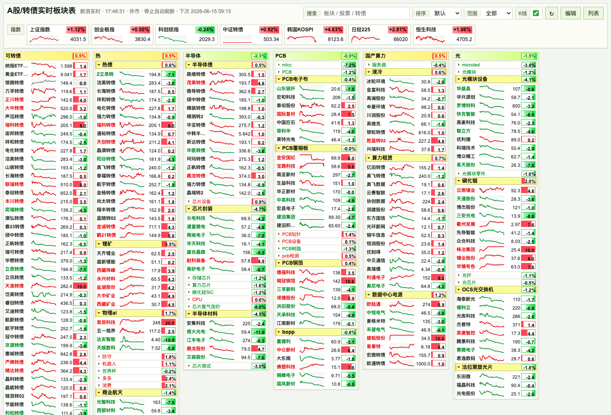

# A股/转债实时板块表


一个给盘中盯板块、盯转债用的本地实时行情看板。界面按短线板块池风格设计：小卡片、高密度、红涨绿跌、涨跌幅条按方向和幅度显示，适合快速扫板块强弱和转债活跃度。



## 功能

- 实时显示 A 股、ETF、港股和可转债行情。
- 支持板块、叠组、个股/转债的增删改和拖拽排序。
- 叠组可以把多个二级细分板块像卡牌一样收纳，多个分组可同时展开。
- 涨跌幅格子按方向和幅度显示红绿条，超过阈值才强化标红/标绿。
- 顶部显示主要指数：上证指数、创业板指、科创综指、中证转债、韩国 KOSPI、日经 225、恒生科技。
- “K线”开关可显示或隐藏每只标的的今日分时缩略走势。
- “转债星图”按申万一至三级行业或主线题材展示全部转债；面积可切换成交额/发行规模，色彩可切换涨跌幅/转股溢价率/价格，并可用 MiniQMT 更新盘中价格、涨跌幅和成交额。小格会按可用空间缩写简称，悬浮板块标题可查看完整转债列表和今日分时缩略线。
- 单债详情支持“分时 / 日K”切换；日K可查看近60、120或250个交易日的转债蜡烛图、MA5/MA10/MA20和成交额，双击某根K线可按日期从MiniQMT读取并切换到当日历史分时。
- 搜索和添加标的优先走本地沪深 A 股名单，远程联想只作兜底。
- 当前板块、叠组和标的池保存到 `data/board-state.json`，不同浏览器打开时使用同一份默认数据。

## 快速启动

```bash
npm start
```

打开：

```text
http://localhost:5173
```

更新本地沪深 A 股联想名单：

```bash
npm run update:stocks
```

## 编辑方式

点击页面右上角的“编辑”后，可以直接在界面上维护板块和标的：

- 板块标题旁的 `+` 可以按名称或代码联想添加股票、ETF、港股或可转债。
- 板块和叠组支持拖拽，也可以用置顶/置底按钮快速移动。
- 个股和转债支持拖拽排序、删除。
- 叠组内的小板块可独立折叠/展开，也能调整顺序。

批量编辑时支持下面的格式：

```text
板块|名称|代码
光模块|中际旭创|300308
白酒|贵州茅台
可转债|韦尔转债|113616
港股|腾讯控股|00700
ETF|科创50ETF|588000
```

省略代码时会用名称自动查询。常见代码格式如 `600519`、`sh600519`、`sz000001`、`113616`、`00700` 也能识别。

## 数据来源

前端只访问本地 Node 服务，由后端统一代理外部行情接口：

- `/api/miniqmt/quotes`：A 股、ETF、可转债优先使用 MiniQMT `full_tick` 实时行情；单只缺失或 Bridge 暂时不可用时回退到 `/api/quotes`。
- `/api/miniqmt/daily`：通过 QMT Bridge 补齐并读取指定转债的日线行情，支持60/120/250日视图；服务内五分钟缓存避免重复下载。
- `/api/auction/series`：服务端在 09:15–09:25:30 每 3 秒采集当前看板沪深标的的 MiniQMT 竞价快照，保存竞价价格、累计金额与增量金额；网页首次读取历史，后续按 cursor 增量更新。
- `/api/quotes`：新浪行情兜底，并继续负责 MiniQMT 不覆盖的港股等标的。
- `/api/indices`：国内和外围指数报价；上证、创业板、科创综指来自新浪报价，中证转债来自腾讯报价，韩国 KOSPI / 日经 225 / 恒生科技使用对应外围指数源。
- `/api/sparks`：今日分时缩略走势，腾讯分时 `ifzq.gtimg.cn` 优先；港股额外使用 Yahoo 港股分时兜底；东方财富分时和新浪 5 分钟 K 线作为后续兜底。

集合竞价期间，卡片缩略图会切换为 MiniQMT 竞价价格线和金额柱；09:25:30 后冻结到 09:30，随后恢复普通盘中分时缩略图。竞价采样缓存写入 `runtime/auction-series.json`，不纳入 Git。
- `/api/search`：添加标的联想，本地沪深名单优先，东方财富远程搜索兜底。
- `/api/state`：读取和保存 `data/board-state.json`。

顶部指数 K 线的当前顺序：

- A 股指数：腾讯分时 -> 新浪 5 分钟 K 线。
- 中证转债：腾讯分时。
- 恒生科技：腾讯分时 -> Yahoo 分时。
- 韩国 KOSPI / 日经 225：Yahoo 分时 -> 东方财富分时。
- 指数没有真实分时数据时不画假线；个股没有分时数据时会按当前价画平线占位，并在提示里标明。

## 项目结构

```text
.
├── app.js                    # 前端交互、行情渲染、编辑逻辑
├── server.js                 # 本地 Node 行情代理和状态 API
├── styles.css                # 板块表样式
├── index.html                # 页面入口
├── bond-heatmap.html         # 可转债全市场星图
├── bond-heatmap.js           # 星图布局、筛选和 MiniQMT 行情刷新
├── bond-heatmap.css          # 星图样式
├── data/
│   ├── a-share-list.json     # 本地沪深 A 股联想名单
│   ├── convertible-bond-heatmap.json # 转债行业/题材基础快照
│   └── board-state.json      # 默认板块/叠组/标的池
└── docs/assets/
    └── finance-board.png     # README 截图
```

## 说明

- 这是本地自用看板，不是交易系统，也不提供投资建议。
- 盘中自动刷新，收盘和非交易时段会降低不必要的请求。
- 浏览器本地存储只作兜底；后端可用时以 `data/board-state.json` 为准。

## License

MIT
