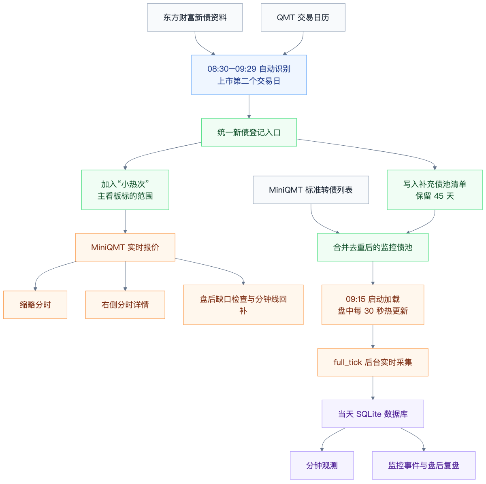

# 新债统一登记与 MiniQMT 监控链路

日期：2026-08-24  
状态：当前实现链路图

## 图示变化

| 维度 | 旧图 | 最新图 |
| --- | --- | --- |
| 新债入口 | 第二交易日判断后直接写 `board-state.json` | 进入统一新债登记入口，再分发到主看板和补充债池 |
| QMT 滞后 | 主要依赖 MiniQMT 转债列表和一次性第二日识别 | 补充债池保留 45 天，支撑标准列表滞后时的监控补偿 |
| 监控池 | 9:15 启动主力监控，链路较分散 | 标准转债列表 + 补充债池合并去重后统一加载，盘中每 30 秒热更新 |
| 行情消费 | 看板实时采样、缩略图、右侧详情分开表达 | MiniQMT 实时报价统一供给缩略分时、右侧详情和盘后分钟线回补 |
| 数据落盘 | “每日分钟数据库与信号”表述较粗 | 明确拆成当天 SQLite、分钟观测、监控事件和盘后复盘 |
| 维护链路 | 盘后扫描和 1 分钟回补单独连接 | 看板报价链路直接连接到盘后缺口检查与分钟线回补 |

## 最新架构图

可编辑源文件：[`2026-08-new-bond-monitor-flow.mmd`](./2026-08-new-bond-monitor-flow.mmd)

图中的“补充债池”对应当前运行时 `runtime/new-bond-universe.json`；当前实现还会对近 45 日新债做每日存量对账，避免只依赖上市第二日窗口而漏掉合金转债这类标的。

历史分钟下载另有硬门禁：monitor 进程退出后，工作日午盘休市或 15:12–18:00 维护窗口才允许执行；连续交易时段、周末、18:00 后均拒绝。

QMT 历史 tick 的独立验证方法和字段结构见 [`miniqmt-historical-tick.md`](./miniqmt-historical-tick.md)。需要区分：项目批量维护队列的并发门禁是安全策略，不是 QMT `period="tick"` 接口的技术前提；本次已在 QMT 本地缓存中完成单券、单日盘后 tick 下载和回读验证。
