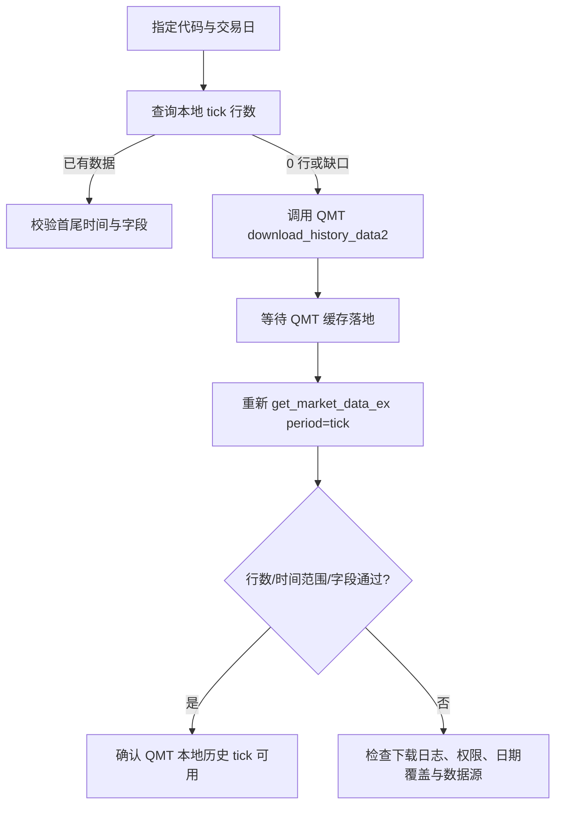

# MiniQMT 历史 tick 下载、查询与数据结构

日期：2026-08-25  
状态：已通过 QMT 本地缓存实测；当前仅记录验证方法，不接入项目业务链路

## 结论

QMT 盘后可以获取历史 tick。`get_market_data_ex(period="tick")` 返回 0 行时，首先应判断为本地历史 tick 缓存尚未下载，而不是直接判断接口不支持或标的没有 tick。

本次用 `123278.SZ` 验证 `20260824`：

| 阶段 | 调用 | 结果 |
| --- | --- | --- |
| 下载前 | `period="tick"` | 0 行，但列结构正常 |
| 下载 | `download_history_data2([code], "tick", date, date)` | 调用无异常 |
| 等待缓存落地后回读 | `period="tick"`, `count=100000` | 4805 行 |
| 时间范围 | `index` | `20260824150000`，首条为 `20260824091500` |

下载写入的是 QMT 的 `userdata_mini/datadir` 缓存，不是 finance 项目目录，也不会自动写入项目 SQLite。

## 为什么上一轮只有三条

上一轮查询使用了 `count=3`：

```python
xtdata.get_market_data_ex(
    [], ["123278.SZ"], period="tick",
    start_time="20260824093000",
    end_time="20260824150000",
    count=3,
    dividend_type="none",
    fill_data=False,
)
```

`count=3` 表示只取查询范围末尾的三条，不代表当天只有三条。因此返回：

```text
20260824145942
20260824145951
20260824150000
```

它们分别表示 14:59:42、14:59:51、15:00:00 的三条历史 tick 快照。tick 不是固定每秒一行的分钟桶；记录数量由 QMT 数据源的报价/成交更新粒度决定，不能把三条记录解释成三分钟或三秒完整行情。

查询完整范围时，应提高 `count`，并自行校验首尾时间和行数：

```python
rows = xtdata.get_market_data_ex(
    [], ["123278.SZ"], period="tick",
    start_time="20260824000000",
    end_time="20260824235959",
    count=100000,
    dividend_type="none",
    fill_data=False,
)["123278.SZ"]

print(len(rows))
print(rows[0]["time"], rows[-1]["time"])
```

## 可复用的获取流程



关键点：下载函数返回不等于缓存已经可读，必须等待后重新查询；验证不能只看 HTTP 200 或下载调用是否无异常。

## 数据结构

### QMT 原生查询结构

当前 QMT 原生 `get_market_data_ex(..., period="tick")` 返回的核心列为：

```text
time
lastPrice
open
high
low
lastClose
amount
volume
pvolume
stockStatus
openInt
lastSettlementPrice
askPrice
bidPrice
askVol
bidVol
settlementPrice
transactionNum
```

### Bridge JSON 适配结构

通过 Bridge 查询时，适配层还会返回或补充：

```text
index              YYYYMMDDHHMMSS 字符串时间索引
time               Unix 毫秒时间戳
lastPrice/open/... 价格与当日统计字段
amount/volume      累计成交额、累计成交量
askPrice/bidPrice  五档价格数组
askVol/bidVol      五档数量数组
tickvol            当前 tick 成交量字段（以实际源字段为准）
transactionNum     成交笔数/成交序号字段
pe                 供应商适配层字段，可能为 0
```

Bridge 返回字段比原生 DataFrame 多，不应把 Bridge 的字段集合与原生 DataFrame 列集合直接当成完全相同的 schema；统一入库前需要保留 `source`、`asOf`、`instrumentId` 和字段映射。

## 与项目现有存储的边界

当前项目的历史补数和监控数据库主链路是分钟级：补数接口调用 `period="1m"` / `download_minute_bars`。项目目前没有把 QMT 历史 tick 自动导入 Monitor SQLite 的 tick 表，也没有历史 tick 回放 API。

因此当前验证分为两层：

1. **QMT 本地缓存验证**：下载到 QMT `userdata_mini/datadir`，用原生或 Bridge `period="tick"` 回读。
2. **项目数据落盘**：目前没有自动发生；若未来需要 tick 复盘，应单独设计 raw tick 表、批次状态、去重键和保留策略，不能把分钟观测表冒充 tick 表。

## 维护窗口说明

项目维护队列仍可对批量历史下载保留串行、停 monitor 和时间窗口门禁，因为项目文档已有同一 QMT/Bridge 全局锁等待的实测记录；这属于并发安全策略，不是 QMT 历史 tick API 的必需条件。

本次单券、单交易日的 QMT 原生 tick 下载在盘后独立验证成功，不能据此推导大批量下载与实时采集并发也一定安全。
