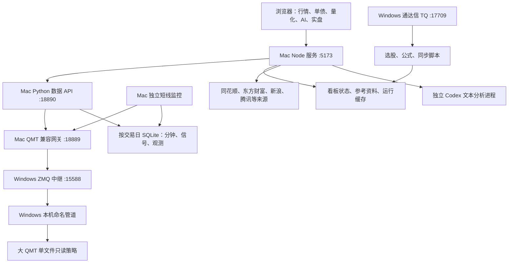
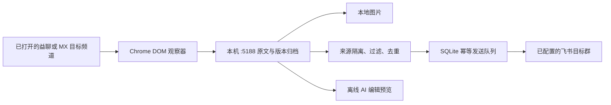
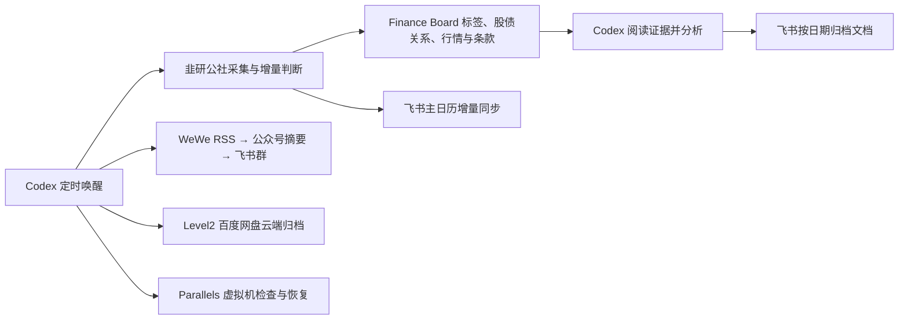

**Finance Board：当前架构与流程总览**

核对日期：2026-11-01，北京时间。范围是本机工作区代码、相关外部监控程序、LaunchAgent 配置及少量只读接口实测。当前分支为 `codex/miniqmt-dashboard`，存在大量未提交修改和新增文件；本文描述本机现状，不等同于 GitHub `main` 已发布内容。本次梳理没有部署、重启服务或执行交易。

**项目定位与技术形态**

项目已形成以 A 股和可转债为中心的本地研究工作台，包含行情看板、转债图表、盘中信号、选股与自动归组、量化回测与模拟盘、AI 研究、受控手工交易，以及独立的消息归档与转发服务。

前端是原生 HTML/CSS/JavaScript 多页面，图表主要由 Canvas 等页面代码绘制；Node 使用内置 HTTP 服务，Python 提供数据与交易适配，数据采用 JSON、SQLite 和内存缓存分层保存。运行上是多个协作进程，业务代码仍以大文件为中心，正在逐步抽取模块。没有完成整套分层重构，也没有统一迁移到单一数据库。

**主运行链路**

下图箭头表示调用、读取或写入方向。Windows 部分依据当前配置与部署代码绘制，本次未进入 Windows 验证终端进程。

`/api/miniqmt/*`、`miniqmt-dashboard-api.py` 和监控名称中的 MiniQMT 有兼容旧接口的含义，不能仅凭名字判断当前行情来自 MiniQMT。

**各层职责与服务管理**

| 组件 | 主要职责 | 运行及入口 |
| --- | --- | --- |
| 浏览器页面 | 渲染、筛选、编辑、定时读取、图表和确认交互 | 从 Node 5173 加载；正常业务通过本地 API |
| Node 主服务 | 静态文件、API 聚合、看板状态、竞价采样、新债与天梯归组、研究任务、Python 子进程管理 | [server.js](/Users/seasnake/code/snake/finance/server.js)；`com.seasnake.finance-board` |
| Python 数据 API | QMT 适配、读监控 SQLite、分钟与日线合并、指标、资料补充、维护队列、交易校验 | [miniqmt-dashboard-api.py](/Users/seasnake/code/snake/finance/scripts/miniqmt-dashboard-api.py)；127.0.0.1:18890；Node 自动拉起并管理其子进程重启 |
| QMT 兼容网关 | 行情源选择、超时与熔断、字段兼容、昨收修正、交易路由隔离 | [qmt_compat_gateway.py](/Users/seasnake/code/snake/finance/scripts/qmt_compat_gateway.py)；127.0.0.1:18889；独立 LaunchAgent |
| 大 QMT 适配 | 券商终端中的只读策略，通过本机管道交给外部 ZMQ 中继 | 当前地址 `10.211.55.3:15588`；[中继程序](/Users/seasnake/code/snake/finance/scripts/qmt_pipe_zmq_relay.py) |
| 独立短线监控 | 全市场轮询、分钟聚合、指标事件、数据落库、盘后校验 | [shortline_monitor.py](/Users/seasnake/Documents/Codex/2026-07-27/miniqmt/outputs/miniqmt_cb_shortline_monitor/shortline_monitor.py)；不在 finance 仓库内 |
| 消息归档服务 | 页面消息归档、图片保存、版本、过滤、去重与飞书队列 | [prince/server.py](/Users/seasnake/code/snake/finance/scripts/prince/server.py)；127.0.0.1:5188；独立 LaunchAgent，当前未加载 |

Node 当前监听 `*:5173`，网关和 Python API 监听回环地址。实盘写入、模拟盘修改和 AI 等入口有各自的访问限制，不能把这些限制理解为整个站点已经具备统一用户认证。

QMT 网关只保留大 QMT 行情与历史数据路径。MiniQMT 已停用并移除自动回退、手动选择和昨收交叉查询。当前交易路由为 `disabled`，账户页面不可用，大 QMT 订单与撤单 RPC 关闭。

大 QMT 当前适配版本为文档及部署脚本固定的 `xtquant-big-convert 0.3.74`。受券商终端文件访问限制，当前采用单文件策略 → 命名管道 → 外部网络中继。旧 FormulaServer 快速资料通路不能当作当前可靠主路径；资料、行情、历史和日历主要经过策略管道。网关保留与原 QMT Bridge 相同的 HTTP 契约，减小上层改动。

**页面与业务模块**

| 模块 | 入口 | 当前能力 |
| --- | --- | --- |
| 主看板 | [index.html](/Users/seasnake/code/snake/finance/index.html)、[app.js](/Users/seasnake/code/snake/finance/app.js) | 股票/ETF/港股/转债、板块与叠组、分时缩略图、指数与外围、盘中信号、竞价、新债和连板归组 |
| 单债详情 | [bond.js](/Users/seasnake/code/snake/finance/bond.js) | 分时/日 K、紫线及其他分钟指标、正股联动、五档、资料、历史分时和补数 |
| 转债星图 | [bond-heatmap.js](/Users/seasnake/code/snake/finance/bond-heatmap.js)、[bond-landscape.js](/Users/seasnake/code/snake/finance/bond-landscape.js) | 行业/题材/标签分组，面积与颜色编码，分组预览和行情刷新 |
| 标签管理 | [bond-tags.js](/Users/seasnake/code/snake/finance/bond-tags.js) | 标签增删、批量维护、主标签和人工覆盖 |
| 次新债表现 | [new-bond-performance.js](/Users/seasnake/code/snake/finance/new-bond-performance.js) | 近 1/2/6 个月新债的 15/30/60 分钟或日线曲线，价格/收益率比较与覆盖说明 |
| 活跃转债指数 | [active-bond-index.js](/Users/seasnake/code/snake/finance/active-bond-index.js) | 复刻等权指数、成分宽度、成交额和成分债排序；与通达信官方指数分开 |
| 连板天梯 | [limit-ladder-board.js](/Users/seasnake/code/snake/finance/lib/limit-ladder-board.js) | 已整合为主看板原生叠组；旧独立页面跳回主看板 |
| 公式选股 | [tdx-formulas.js](/Users/seasnake/code/snake/finance/tdx-formulas.js) | 读取通达信公式任务快照，展示命中、覆盖和进度 |
| 量化实验室 | [quant.js](/Users/seasnake/code/snake/finance/quant.js) | 六个单券日线策略、三个组合轮动策略、日内组合确认、ATR 网格、本地模拟盘 |
| AI 分析 | [bond-ai.js](/Users/seasnake/code/snake/finance/bond-ai.js) | 数据预览、关注点、任务进度/取消、历史报告、上下文核对与导出 |
| 实盘 | [trading.js](/Users/seasnake/code/snake/finance/trading.js) | 账户、持仓、委托、成交读取，以及受控手工限价下单/撤单代码 |
| 小王子/快讯归档 | [web/prince](/Users/seasnake/code/snake/finance/web/prince) | 独立于主看板的消息、图片、过滤与推送队列查看 |

**数据源及使用口径**

| 数据 | 当前来源与边界 |
| --- | --- |
| 主看板沪深股票、ETF、转债报价 | QMT `full_tick`；统一走网关选择的数据源；失败保留已标记缓存或显示缺失 |
| 北交所报价 | Node 从同一网关补充，绕过只接受 SH/SZ 的 Python 报价入口；全天分时未完整接入 |
| 上证、创业板、科创综指 | 当前代码优先 QMT，失败后使用新浪；部分 README 文字仍写新浪优先 |
| 中证转债及外围 | 腾讯、新浪、Yahoo、东方财富等按不同标的提供报价或曲线；不能将所有卡片视为同一源 |
| 港股 | 主看板报价经新浪代理，分时按对应外部来源读取 |
| 纳指代理、布油、美债收益率 | TradingView 相关图表/数据；美债为非官方 scanner 快照，本次采样曲线不等于全天历史分时 |
| 分钟、日线 | QMT 缓存、监控 SQLite、看板实时样本和持久化回补缓存；合并时保留时间与覆盖信息 |
| 新债、上市与生命周期、条款 | 东方财富等资料源、QMT 交易日历、公告正文、集思录强赎观察及人工覆盖 |
| 连板池 | 同花顺 Agent 完整分页涨停池为主，东方财富作核验、备用与北交所补充 |
| 组合回测因子 | 东方财富历史转债截面；成交开盘价优先 QMT 日 K，缺失时明确用东方财富日 K 补齐 |
| 通达信选股 | Windows TQ 本地服务；现有公式与其本地 K 线，结果独立于本地公式实验 |
| AI 理论摘要 | 固定提示词、已核对的预言家课程/文章摘要与转债知识文件，不自动加载全部私人资料 |

昨收修正以报价所属交易日对应的前一有效日线收盘为依据，避免周末用错基准。MiniQMT 交叉验证代码已移除；不能把大 QMT 自身日线修正描述成已经过 MiniQMT 复核。

**状态与存储分层**

| 数据类别 | 位置 | 维护方式 |
| --- | --- | --- |
| 共享看板状态 | [board-state.json](/Users/seasnake/code/snake/finance/data/board-state.json) | 板块、标的、叠组；服务端锁、原子写、`baseUpdatedAt` 冲突检测；不是每个浏览器一份权威状态 |
| 参考与人工资料 | [data](/Users/seasnake/code/snake/finance/data) | A 股目录、标签底稿/生成结果/人工覆盖、指数研究快照、AI 摘要和新债参考修正 |
| 页面本地偏好 | 浏览器 localStorage | 显示开关、布局与本地编辑副本/备份；不能代替服务端共享状态 |
| 主项目运行数据 | [runtime](/Users/seasnake/code/snake/finance/runtime) | 报价快照、竞价当日与按日归档、新债池、生命周期、行业映射、天梯池/归属/备份、行情源选择 |
| 研究与执行记录 | [runtime](/Users/seasnake/code/snake/finance/runtime) | 模拟盘 JSON、AI 报告、组合因子缓存、公式快照、市场 SQLite、交易审计 JSONL |
| 看板补数 | [intraday-backfill-jobs.json](/Users/seasnake/code/snake/finance/runtime/intraday-backfill-jobs.json)、[intraday-backfill-cache](/Users/seasnake/code/snake/finance/runtime/intraday-backfill-cache) | 持久化任务与按代码/日期保存的分钟数据 |
| 监控数据 | [外部监控 runtime](/Users/seasnake/Documents/Codex/2026-07-27/miniqmt/outputs/miniqmt_cb_shortline_monitor/runtime) | 每日 SQLite、status/service、指标预热状态、报告、CSV、看板采样数据库等 |
| 消息存档 | [finance-prince 数据目录](</Users/seasnake/Library/Application Support/finance-prince>) | SQLite 原文与版本、媒体、过滤记录、幂等发件队列及本地配置 |

监控每日库主要含 `minute_observations`、`qmt_events`、`tdx_events`、`runtime_samples`、`matches`、`meta`。分钟价格可以回补，停机时没有观察到的派生事件不能凭历史分钟线原样恢复。

`runtime/`、日志、临时文件和导出目录被 Git 忽略。看板数据与人工覆盖默认不随功能提交；只有明确要更新共享默认值时才一并提交。只备份 Git 仓库无法保全外部监控库、运行缓存、消息库及 Windows 配置。

**启动与日常运行流程**

1. macOS LaunchAgent 拉起 Node 主服务和独立 QMT 网关。Node 先检查 Python API，必要时启动它；其子进程退出后按指数退避重试，最长间隔 30 秒。
2. Node 启动初始化包括行业资料、债券生命周期、竞价历史读取、新债扫描和天梯更新。生命周期同步成功后可清理已不活跃的看板债券。
3. 独立监控 LaunchAgent 在工作日 09:15 触发，并每 300 秒检查。调度器只在约定日间窗口启动监控，已经运行时不重复启动；默认 15:10 停止并产出报告。
4. 浏览器读取服务端状态和最近有效报价快照，随后按市场时段刷新。休市复用缓存时保留数据日期，不把页面加载时间当成行情时间。

当前主看板名义刷新间隔：普通行情 15 秒、转债快速行情 5 秒、指数 5 秒、主力信号 2 秒、竞价 3 秒、美债 30 秒。主行情/指数等考虑隐藏页与市场状态；不同模块各有调度，不能概括为所有后台请求都停止。

编辑流程是“页面改动 → 保存请求携带旧版本时间 → 服务端重新读取并加锁 → 校验/生命周期过滤 → 原子替换 → 返回新版本”。版本过期返回 409，避免两个页面或自动归组相互覆盖。自动归组也复用状态锁，并保留无法确认归属的用户内容。

**盘中监控与竞价流程**

监控债池来自 QMT 当前转债列表与新债补充清单。程序加载资料、预热当日分钟指标，默认以约 1 秒目标间隔轮询行情，按分钟聚合 OHLC/成交额，默认每 5 秒增量落库。页面通过 Python API 读取事件和指标。轮询间隔是目标值，会受上游请求耗时影响。

信号包括涨速/加速、区间放量、盘口可见大单、MACD、紫线、分时均价、明盘/暗盘等。分钟信号用已完成分钟确认，并保留来源分钟与幂等键。明暗盘是由分钟价格和均线推导的技术指标，盘口大单是普通五档观察，不等同于 Level-2 逐笔资金事实。通达信旁路每约 30 秒采样作对照，没有转债真值时报告不能用股票样本替代。

竞价由 Node 独立采样：09:15–09:25:30 每 3 秒采集看板标的及相关股债配对，计算价格、累计成交额和增量成交额，约每 30 秒持久化，并保留按交易日归档。前端用 cursor 增量读取；09:25:30 后冻结到 09:30，再切回普通分时。09:25 前虚拟撮合价只作展示，日内策略不把它当作实际成交。

**新债、生命周期、标签与连板归组流程**

新债流程：动态上市资料 → QMT 交易日历 → 上市第二交易日识别 → 幂等加入“小热次” → 统一新债清单 → 监控与标签等消费者。盘前扫描窗口默认 08:30–09:29:30、每分钟一次；新债清单保留近 45 天，并有存量对账，避免完全依赖第二日单一窗口。监控每 30 秒热加载补充池。

生命周期数据用于过滤退市/终止等不活跃债券；行业映射和标签由生成底稿、动态资料与人工覆盖合并。人工主标签控制星图归属，重建标签时保留人工设置。

连板流程：取正确交易日 → 同花顺完整分页池 → 东方财富交叉核验/北交所补充 → 形成带日期与来源的分组计划 → 保存日备份 → 在状态锁内更新看板与归属清单。服务端每分钟扫描，前端每 10 秒读取归组状态。盘前展示上一交易日实际连板数，盘中按当日涨停池分组；板数不从涨幅推算。源故障或冲突时保留上次结果并标记待重试。

**历史分钟补齐有两套流程，必须分别理解**

| 流程 | 触发与执行 | 当前限制 |
| --- | --- | --- |
| 看板 Python 维护队列 | 手动刷新、量化回放缺口、盘后扫描 → 优先级队列 → 单标的下载 → 回读验证 → 持久化分钟缓存 | 先确认监控停止；工作日午休或 15:12–18:00 允许维护；周末允许人工任务，自动全市场任务仍受工作日窗口限制；连续故障冷却 |
| 独立 Monitor 的背景修复 | 指标预热/恢复后发现部分标的分钟不完整 → 单标的后台 worker → 合并指标状态 | 当前 `service_control.py` 明确启用了缓存重读与下载，并设 5 秒调度间隔；与上述“监控停止后维护队列”不是同一门禁 |

第二条的当前启动代码已经不同于 Monitor README 中“默认不带后台修复参数”的描述。不能再笼统写成“所有盘中历史下载都被禁止”。两者共同依赖 QMT 上游容量，判断数据是否补齐应看回读覆盖，而不能只看下载接口成功。

**量化研究与模拟盘流程**

| 能力 | 输入与引擎 | 成交/数据边界 |
| --- | --- | --- |
| 六个单券日线策略 | MA20、MACD、EMA5/20、日线紫线、布林、唐奇安；[cb-quant-engine.js](/Users/seasnake/code/snake/finance/lib/cb-quant-engine.js) | 收盘出信号，下一根日 K 开盘模拟成交；缺日可尝试分钟聚合补齐 |
| 三个组合轮动 | 双低、三低、六因子；[cb-portfolio-engine.js](/Users/seasnake/code/snake/finance/lib/cb-portfolio-engine.js) | 历史截面排名与再平衡；必要字段缺失则排除，历史余额只向后结转；强赎/下修公告时点过滤仍不完整 |
| 日内组合确认 | 09:25 股债竞价、分钟指标、已留存事件；[cb-intraday-engine.js](/Users/seasnake/code/snake/finance/lib/cb-intraday-engine.js) | AUCTION → SETUP → TRIGGERED → POSITION → 止盈/止损/尾盘退出；下一分钟模拟成交，结构止损、R 倍数止盈和折扣凯利预算 |
| ATR 动态网格 | 已完成的前序日线 ATR 与当日分钟；[cb-atr-grid-engine.js](/Users/seasnake/code/snake/finance/lib/cb-atr-grid-engine.js) | ATR 控制网格宽度，日内均线调整基准；缺盘口时明确使用下一分钟开盘近似 |
| 本地模拟盘 | 页面设置 → Node 策略周期 → 有效行情 → 纸面账户 | 独立 JSON 现金/持仓/成交；只接受符合日期、时段和新鲜度要求的行情；重启后需手动恢复运行 |

这些入口位于 `/api/cb-quant/*`，不进入真实账户下单链路。回测费用、滑点、数据覆盖与缺失需一并看；现有研究不代表完整逐笔撮合、历史条款时点或样本外稳定性已经验证。

**AI 分析流程**

选择转债、日期及最近 1–5 日范围 → 只读本地日线/分钟 → 个债资料接口补充正股、转股价和公告 → 校验日期/单位/覆盖并冻结快照 → 加入固定理论摘要与关注点 → 创建后台任务 → 调用隔离的 Codex 文本进程 → 保存原始正文、完整输入、模型与提示词版本 → 页面查看/取消/导出。

实现由 [cb_ai_snapshot.py](/Users/seasnake/code/snake/finance/scripts/cb_ai_snapshot.py)、[cb-ai-context.js](/Users/seasnake/code/snake/finance/lib/cb-ai-context.js)、[cb-ai-service.js](/Users/seasnake/code/snake/finance/lib/cb-ai-service.js) 和 [codex-text-provider.js](/Users/seasnake/code/snake/finance/lib/codex-text-provider.js) 组成。代码默认模型为 `gpt-6-astra`、推理强度 `high`，可通过环境覆盖；本次未执行新分析核验模型可用性。

分析进程复用本机登录，在独立临时目录中接收文本快照，关闭浏览、应用与命令工具。生成报告不连接交易操作，也不自动持续盯盘。历史分析限制数据截至分析日；当前余额、发行规模、历史余额、发行评级和最新评级分开处理。保存任务保留最近 50 个已结束报告；服务重启会把未完成任务标记中断。

**实盘操作流程与当前路由**

账户与交易通道当前停用；实盘页面不再请求旧 MiniQMT 服务。迁移账户查询需另行实现和验收，不能把行情恢复视为账户功能恢复。

手工操作代码：本机同源访问 → 输入解锁语句获得临时会话 → 校验账户标签、资金/可卖量、实时价格、数量及限价 → 生成 30 秒预览令牌 → 完整确认语 → 一次性消费令牌 → 调用订单/撤单 → 记录审计。默认解锁会话 10 分钟、单笔金额上限 2 万元、价格偏离上限 5%。核心是 [trading_execution.py](/Users/seasnake/code/snake/finance/scripts/trading_execution.py)。

交易选择器不随行情切源变化，也不因超时自动换后端重发。当前大 QMT 查询链路的接入不代表大 QMT 真实交易迁移已完成。本次未解锁、预览或发出任何交易请求。

**通达信相关的四条流程**

| 方向/任务 | 行为 |
| --- | --- |
| 通达信 → 看板 | 从 TQ 自定义板块或导出文件读取，标准化代码并解析名称，默认生成预览；显式 apply 后经 `/api/state` 乐观锁写入并回读验证 |
| 看板 → 通达信 | 同步脚本把选定板块映射为通达信自定义板块；默认预览，apply 会创建/清空/重填目标板块，与导入方向不同 |
| 通达信公式 → 结果页 | 检查已有“单针、异动、ZX”，在可转债分类批量计算并续存快照；打开网页只读结果，不自动执行公式或下载盘后行情 |
| 本地公式旁路 | 本地 QMT 日线与 SQLite 计算结果对账；仍属验证用途，不能声称所有公式已与通达信完全一致 |

`src/domain`、`src/application`、`src/infrastructure` 的第一条完整分层实现主要就是选股导入与公式任务：纯规则、用例编排和 TQ/文件/API 适配分开，尚未覆盖整个项目。

**独立消息服务流程与暂停状态**

当前扩展代码版本的行为是观察自然显示的目标频道消息，不主动请求 MX 消息接口、不翻页、不自动打开或刷新标签页。历史消息与新观察消息分开；历史导入默认不进实时推送队列。文字按规则去重，图片使用像素签名，发送有幂等标识与回执审计。

服务代码和既有配置支持小王子与快讯分别路由，快讯还有广告/研报/荐股等确定性过滤。AI 编辑仅是离线预览，未接入实时飞书队列。

较早的快讯 runbook 仍写 15/30 秒主动 API 轮询与自动开页，已被后续暂停与 DOM 观察改动取代。当前文档标记扩展暂停；本次实测 5188 不监听，两个相关 LaunchAgent 未加载。Chrome 扩展开关未单独核验，不能把旧文档中的采集/转发验收当作今天正在运行。

**外部业务定时任务：Codex 调度层**

2026-11-01 补充核对：本机 Codex 共保存 10 个自动化配置，其中 8 个与金融项目或金融数据有关，当前这 8 个全部为 `PAUSED`。配置仍保留；不能把早先的执行记录当成当前仍在自动运行。另两项是通用每周回顾和动画续作，不计入金融项目。

| 任务 | 北京时间调度与条件 | 主要流程/产物 | 当前状态 |
| --- | --- | --- | --- |
| 盘前纪要｜交易日转债分析 | 每天 08:00 唤醒，核验当天为沪深交易日才分析 | 读取指定作者全文与图片 → 匹配看板有效标签和股债关系 → 核验行情/条款 → 发布飞书“新闻事件/日期”目录 | 暂停；[配置](/Users/seasnake/.codex/automations/automation-5/automation.toml) |
| 交易日早晨 PD 虚拟机检查 | 工作日 08:15；另核验交易日，日历不可用时仍检查并说明 | 检查 Windows 11 的真实 VM 状态，停止/挂起时启动或恢复，再双重确认；不检查或修改虚拟机内的 QMT 策略 | 暂停；[配置](/Users/seasnake/.codex/automations/pd/automation.toml) |
| 可转债公众号早盘简报 | 每天 08:55 | WeWe Docker/RSS 全文 → 未推送文章摘要 → 飞书“可转债”群 → 成功后记录去重状态 | 暂停；[配置](/Users/seasnake/.codex/automations/automation/automation.toml) |
| 可转债公众号晚间复盘 | 每天 21:35 | 同一 RSS 与去重状态 → 当日观点、共识/分歧、次日关注 → 飞书群 | 暂停；[配置](/Users/seasnake/.codex/automations/automation-2/automation.toml) |
| 财闻私享｜交易日前夜转债分析 | 每天 21:45 唤醒；明天这个自然日为沪深交易日才分析，包含符合条件的周日晚间 | 指定作者全文与图片 → 新闻映射存续转债 → 验证并发布当日飞书文档，注明面向的下一交易日 | 暂停；[配置](/Users/seasnake/.codex/automations/automation-3/automation.toml) |
| A股投资日历｜主日历增量同步 | 每天 22:00，无交易日限制 | 正文及全部日历图片 → 提取事件与日期 → 与飞书主日历去重 → 增量新增/更新 → 回读记账 | 暂停；[配置](/Users/seasnake/.codex/automations/a/automation.toml) |
| Level2 每日增量转存 | 周一至周五 22:00，脚本再核验实际交易日 | 当天压缩包 → 百度网盘云端转存至日期目录 → 核对路径与字节数；不下载、不覆盖 | 暂停；[配置](/Users/seasnake/.codex/automations/level2/automation.toml) |
| 财闻私享｜无更新临时重查 | 有效周期内每 15 分钟重查，成功发布后自行暂停 | 复用主任务和原目标交易日；仅在出现新文或实质修订后分析发布 | 暂停；[配置](/Users/seasnake/.codex/automations/automation-7/automation.toml)；本地 retry 状态为 completed |

这层业务调度与主看板服务进程分开运行：

韭研公社任务的工作目录在 [jiuyangongshe-finance](/Users/seasnake/.local/share/jiuyangongshe-finance)，不属于 finance 仓库。其 [RUNBOOK](/Users/seasnake/.local/share/jiuyangongshe-finance/RUNBOOK.md)、配置、每作者采集 SQLite、原始图片证据、发布状态与重试状态构成独立任务系统。`prepare.py` 只完成交易日判断与证据采集，阅读分析、飞书写入和回读验收由被唤醒的 Codex 完成。

增量依据是文章 ID、正文与有序图片的指纹；发布成功并回读后才推进水位。财闻私享临时重查沿用原 cycle_date/target_date，跨午夜不顺延研究目标。投资日历按事件身份去重，相同事件换文章不会重复创建，修订保留原日程身份与用户备注。

Level2 任务目前属于网盘归档链路，不能据此认为普通五档监控已经接入 Level-2 逐笔数据。PD 检查只保证 VM 本身运行，不保证 QMT 登录、策略、中继和行情链路正常。公众号任务与小王子/MX 消息观察器也是两套独立来源。

最近本地记录：盘前纪要发布成功时间为 10 月 15 日 08:06；财闻私享为 10 月 14 日 21:58；投资日历最近有变更发布状态为 10 月 11 日，任务记录显示继续检查到 10 月 14 日且无新增；PD 最近日志为 10 月 15 日恢复 VM 至 running，记录当时尚无预期 IPv4。这些来自保存的执行记录，本次没有重新验收远端文档、日历或虚拟机。

旧公众号任务提示词指定的 `wechat-bond-digest-seen.json` 路径本次检查不存在；恢复前需要核对其依赖和推送基线，不能直接认定此前所有文章都未发送。本次只清点，没有恢复或手动运行任务。

**Mac 系统调度、应用内定时器与上述业务调度的关系**

| 调度层 | 当前清点结果 |
| --- | --- |
| Codex 业务自动化 | 上表 8 项均暂停，负责研究、文档/日历发布、归档与 VM 检查 |
| Mac LaunchAgent：主看板与网关 | 已加载、正在运行；登录启动与退出后保活，不是每天生成研究报告的任务 |
| Mac LaunchAgent：短线监控 | 已加载；09:15 启动与每 300 秒检查，受工作日日间窗口限制；休市时子进程停止不表示调度被关闭 |
| Mac LaunchAgent：prince | 配置保留但未加载，当前消息归档/发送服务未运行 |
| Mac LaunchAgent：MX Chrome | 原每 60 秒检查 Chrome 的启动项未加载，当前停用 |
| Node/Python 内部定时器 | 竞价采样、每分钟新债/天梯扫描、补数调度等随相应服务进程运行，与 Codex PAUSED 状态无关 |
| 用户 crontab | 本次检查没有配置 |
| Windows 任务计划 | 历史迁移文档记载 QMT Bridge 计划任务；本次未连接 Windows 清点其当前状态 |

因此，当前“看板和部分采集调度仍在”与“研究简报、投资日历、Level2 转存等业务任务暂停”可以同时成立。

**开发、验证、部署与回滚流程**

1. 在开发分支按完整业务切片修改，先识别现有工作区改动，保留用户看板数据。
2. 运行改动相关检查，再执行 [verify.sh](/Users/seasnake/code/snake/finance/scripts/verify.sh)：JavaScript 语法、Python 编译、根测试目录中的 Node/Python 测试和独立端口本地冒烟。提交 JavaScript 前还需遵守 AGENTS 的语法与 diff 检查。
3. 消息服务的 `tests/prince` 及仓库外 Monitor 测试需要单独运行；不能把根测试命令通过当作这些子系统已全部覆盖。
4. 明确暂存源文件，创建提交与 PR。[GitHub Actions](/Users/seasnake/code/snake/finance/.github/workflows/ci.yml) 在 PR、main push 和手动触发时运行 `repository-verification`。是否在远端设置必需检查，本次未核验。
5. 本机部署依赖当前检出的源文件、Python 环境、外部 Monitor、系统凭据及 LaunchAgent。没有前端打包步骤；Node 进程的代码更新通常需重启服务才能生效，不能只凭文件已修改认定进程已加载。
6. Windows 大 QMT 策略/中继有独立准备与部署脚本，变更不能仅靠 Mac Node 重启生效。固定版本、部署哈希、回退包和只读验收见 QMT 迁移文档。
7. 回滚需要分别考虑源码、看板状态、运行数据与 Windows 适配；天梯按日备份、标签人工覆盖和外部 SQLite 都有各自的保留要求。

本地环回访问必须绕过代理，`NO_PROXY` 与 `no_proxy` 至少包含 `127.0.0.1,localhost,::1`；现有 QMT 服务配置还包含 Windows 地址 `10.211.55.3`。

**2026-11-01 运行状态实测**

| 项目 | 本次观察 | 能证明的范围 |
| --- | --- | --- |
| 主看板 5173 | LaunchAgent running，首页 HTTP 200 | 页面服务存在 |
| Python 18890 | 进程监听，健康接口经 Node 返回 HTTP 200 | 数据服务存在；不代表监控和上游健康 |
| QMT 网关 18889 | 早先检查记录为 auto；现已改为仅 bigqmt，交易 disabled | 路由配置可读取，active 字段不是本次报价成功证明 |
| 代表报价 | `/api/miniqmt/quotes?codes=000001.SH` 实测约 12 秒后 HTTP 503，上游错误为 502 | 当前新报价链路未通过；不能仅凭缓存价格判断已恢复 |
| 独立监控 | health 为 degraded；监控未运行；最近状态为 10 月 30 日 15:10:06 停止 | 今天周日，停止符合时段安排；不单凭这一项判定异常 |
| 最近交易日数据 | 最近记录为 10 月 30 日；状态记录 317 只监控池、6 次累计错误、指标预热 ready | 只是最近保存状态，不是对所有历史逐券完整性的重新验收 |
| 大 QMT 写操作 | 网关配置关闭；交易选择器为 miniqmt，自动切换关闭 | 只读大 QMT迁移边界仍在配置中 |
| 消息服务 | 5188 connection refused；prince 与 MX Chrome 启动项未加载 | 当前本机消息归档/发送服务未启动 |

本次没有修复上述运行状态，也没有重跑完整测试、Windows 部署或真实交易验收。上游错误尚不足以确定是 Windows 关机、网络、QMT 策略还是中继进程导致。

**架构现状与后续规划的分界**

已经落地的是多页面工作台、QMT 兼容网关、独立监控与按日数据、业务缓存、部分纯逻辑引擎、通达信分层用例和本地/CI 验证脚本。

仍在逐步迁移的部分包括：Node 路由/存储/供应商拆分、Python 按领域拆包、前端共享调度和图表模块、统一来源/时间/质量契约、历史债池与条款时点治理。现有代码量约为 `server.js` 5,863 行、`app.js` 6,228 行、Python dashboard 8,140 行，说明核心大文件仍承担多类职责。

需要持续区分三件事：HTTP 服务可达与行情有效、历史价格可补与当时事件可重建、研究/模拟交易与真实账户执行。当前最大维护依赖是跨仓库监控、Windows 终端和本机配置；仅克隆 finance 仓库还不能复原整套运行环境。

**Skill 与开源依赖补充**

完整清单见 [Skill、开源组件与实际部署版本](/Users/seasnake/code/snake/finance/docs/architecture/skills-and-open-source-2026-11-01.md)。其中列出 23 个 QMT Bridge Skills、研究/采集/飞书/Level2 技能、八项自动化的具体 Skill 映射，以及实际安装版本和上游来源。

架构上另有“用户或调度 → Codex Agent → Skill → 脚本/CLI/API → 服务与产物”这一层。主看板通常直接调用代码或 CLI，不会为每次请求加载全部 Skills。AI 分析页面使用固定摘要并关闭宿主技能自动发现。

当前大 QMT 接入的本机安装与最近部署验收版本为 `xtquant-big-convert 0.3.74`，另有本项目单文件管道/中继适配；上游 PyPI 已发布 0.3.78，且上游 README 声明停止更新。它们不能统称“已跑通最新版”。本次只读核对的 finance-board 远端 main 为 `803b2bb`，与本机开发分支和未提交功能也不同。

**详细依据与维护入口**

- [项目 README](/Users/seasnake/code/snake/finance/README.md)
- [QMT 迁移与管道中继](/Users/seasnake/code/snake/finance/docs/architecture/qmt-migration.md)
- [独立短线监控 README](/Users/seasnake/Documents/Codex/2026-07-27/miniqmt/outputs/miniqmt_cb_shortline_monitor/README.md)与[实际启动程序](/Users/seasnake/Documents/Codex/2026-07-27/miniqmt/outputs/miniqmt_cb_shortline_monitor/service_control.py)
- [数据管理方案](/Users/seasnake/code/snake/finance/docs/architecture/data-management.md)与[模块化路线图](/Users/seasnake/code/snake/finance/docs/architecture/2026-08-modularization-roadmap.md)
- [量化实验室说明](/Users/seasnake/code/snake/finance/docs/architecture/cb-quant-lab.md)与[当前量化路由](/Users/seasnake/code/snake/finance/server.js:2313)
- [AI 分析实现说明](/Users/seasnake/code/snake/finance/docs/architecture/cb-ai-analysis.md)
- [连板天梯流程](/Users/seasnake/code/snake/finance/docs/2026-09-07-limit-ladder.md)
- [通达信导入](/Users/seasnake/code/snake/finance/docs/runbooks/tdx-selection-import.md)、[公式任务](/Users/seasnake/code/snake/finance/docs/runbooks/tdx-formula-selection.md)、[本地公式实验](/Users/seasnake/code/snake/finance/docs/runbooks/local-formula-demo.md)
- [消息归档及暂停记录](/Users/seasnake/code/snake/finance/docs/runbooks/prince-archive.md)、[当前扩展说明](/Users/seasnake/code/snake/finance/extensions/prince-observer/README.md)、[离线 AI 编辑](/Users/seasnake/code/snake/finance/docs/runbooks/news-ai-enrichment.md)
- [开发与 CI 工作流](/Users/seasnake/code/snake/finance/docs/development-workflow.md)
