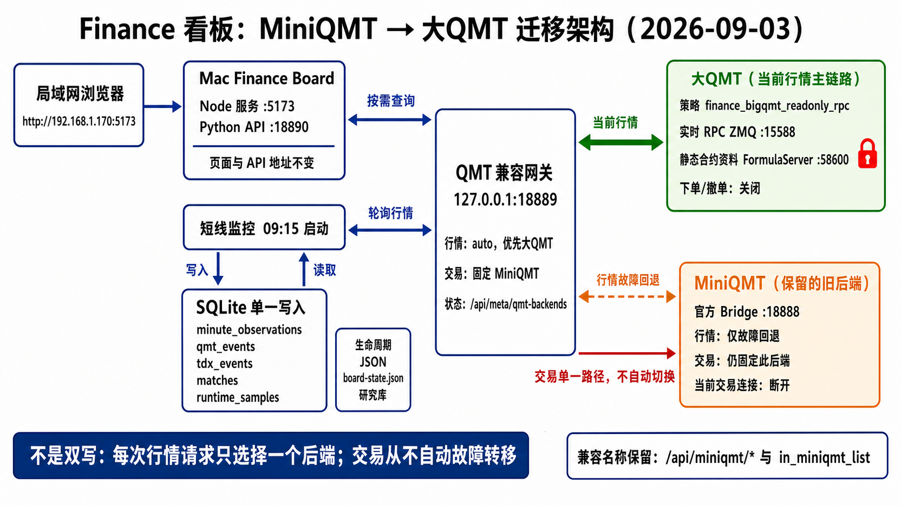

# Finance board: MiniQMT to Big QMT migration



## Decision

Use `xtquant-big-convert==0.3.74` as the Big QMT compatibility implementation.
Keep the finance board, monitor SQLite schema, Python dashboard API, and Node UI
unchanged. A loopback HTTP gateway preserves the existing QMT Bridge contract.

## Current routing (2026-11-01)

MiniQMT is retired. The gateway has only one market backend: Big QMT. The old
HTTP backend, automatic fallback, and previous-close cross-check have been
removed. Legacy `auto` / `miniqmt` market settings normalize to `bigqmt`; a legacy
MiniQMT trading route normalizes to `disabled`. Saved market selections cannot
restore the retired backend. The selection API rejects `auto` and `miniqmt`.

```text
market backend: bigqmt only
trading backend: disabled
Big QMT remote order/cancel: disabled in both gateway and QMT strategy
gateway bind: 127.0.0.1:18889
Big QMT RPC: tcp://10.211.55.3:15588 (external ZMQ relay -> QMT named pipe)
FormulaServer shortcut: disabled
```

Instrument details, ticks, bars and calendars use the strategy pipe. The
external shortline monitor requests one instrument per HTTP call; serialized
batches exceeded its deadline. Do not restore the old FormulaServer path.

Current clients default to the local gateway. Legacy `/api/miniqmt/*` route and
historical storage names are compatibility identifiers, not a running backend.
Older sections and the illustration below describe migration history only.

## 2026-11-01 recovery and MiniQMT retirement verification

- The existing Windows relay was listening, but the QMT strategy pipe had disappeared. The user restarted `FINANCE_BIGQMT_READONLY_PIPE` from model trading. Successful gateway checks after 21:06 returned health, quotes, daily bars and minute bars dated through 2026-10-30.
- MiniQMT HTTP backend, automatic fallback, source-selection options and previous-close cross-check are removed. Active launch configuration, installer defaults and the standalone monitor default now use the local Big QMT gateway. Account/trading routing remains disabled.
- The Wankai (`123247`) page rendered 120 daily bars from 2026-05-07 through 2026-10-30, with a working five-level order book. The home/state/indices routes returned HTTP 200. This is a scoped recovery check, not full-market history coverage or an unattended uptime test.
- Daily loading errors clear the old intraday canvas. Late responses cannot overwrite a different view or a newer range. Missing valuation fields remain missing, and non-trading-day notices show the latest available date.
- Existing `/api/miniqmt/*` URLs and storage identifiers remain compatible; they do not activate the retired service. Existing historical data was preserved.

## Components

- `scripts/qmt_compat_gateway.py`: HTTP contract, backend selection, circuit
  breaker, and write safety boundary.
- `scripts/prepare_bigqmt_rpc_bundle.py`: pins, verifies, and deploys the QMT-side
  ZMQ strategy bundle. It reads only the existing stock account id into QMT's
  private local config; no password or API key is copied. The generated bundle
  is ignored under `runtime/`.
- `scripts/install_qmt_migration.py`: installs the gateway LaunchAgent, backs up
  the affected plist files, and routes finance board plus short-line monitor to
  the gateway.
- `GET /api/meta/qmt-backends`: reports configured/active backend and last
  failure without exposing account ids or credentials.

## Install or refresh

```bash
/Users/seasnake/miniconda3/bin/python3 -m pip install xtquant-big-convert==0.3.74
/Users/seasnake/miniconda3/bin/python3 scripts/prepare_bigqmt_rpc_bundle.py --deploy-parallels
/Users/seasnake/miniconda3/bin/python3 scripts/install_qmt_migration.py
```

In Big QMT, import/start `python/BIGQMT_ZMQ_DRYRUN.py` as a strategy and select
the normal stock account. Startup is read-only: `rpc_allow_order_methods` is
false. Do not reuse the file-signal receiver from the EasyXT guide for this
application; it covers order signals but not the market/history/calendar API
contract used by finance.

## Read-only acceptance

Check all of the following through port 18889 before pinning market reads to
Big QMT:

1. `/api/meta/health` and `/api/meta/qmt-backends` identify Big QMT as active.
2. `/api/cb/list` has the expected active universe.
3. `/api/market/full_tick` returns prices, order book, `time`, and `timetag` for
   multiple refreshes; during a market session the timestamps must advance.
4. Instrument detail, daily/minute `market_data_ex`, trading calendar, asset,
   positions, orders, and trades match the existing field shapes and units.
5. The external monitor writes fresh SQLite rows and the finance API/pages read
   them normally for at least one full trading day.

Only after shadow comparison should the trading selector be changed. That is a
separate cutover requiring an explicit real-trading decision and a controlled
small order/cancel test; it is not part of read-only migration.

## 2026-10-27 restricted-terminal refresh

The client and QMT-side package are pinned to published PyPI version `0.3.74`.
Copying the package alone is insufficient on the current broker terminal:
`FINANCE_BIGQMT_READONLY_RPC` still opens a second Python source file, and
its line 51 now fails with `PermissionError: Forbidden FileIO`.

The replacement layout is:

```text
QMT embedded FINANCE_BIGQMT_READONLY_PIPE (flat single file, no module-file reads)
  -> Windows same-host named pipe finance_bigqmt_rpc_<account>
  -> external Windows qmt_pipe_zmq_relay.py
  -> existing tcp://10.211.55.3:15588
  -> existing Mac HTTP gateway 127.0.0.1:18889
```

- `scripts/prepare_bigqmt_pipe_bundle.py` uses the upstream
  `tools/build_pipe_single_file_flat.py` builder and the installed pinned
  package sources. Its sibling builders are supplied alongside it (the
  0.3.74 wheel ships those in `bigqmt_signal_trader/_singlefile/`). The
  upstream pipe builder used here has Git blob SHA
  `308e3e27a0487625f96b5bb6e4e23483cd8bbba2`.
- The generated strategy bakes in the existing account, disables native xtdata
  socket access and Redis, uses adjust-driven pipe reads, and keeps remote
  order/cancel methods disabled. The package's injected API capture helper is
  used so historical-download globals are bound.
- The external relay owns the existing ZMQ network endpoint. It forwards only
  account-matching query/data-download methods, preserves request IDs, blocks
  trades and maintenance writes, and does not retry an uncertain timeout.
  The Mac connection address and trading selector do not change.
- Private generated files and rollback copies stay under ignored `runtime/`.
  Windows package deployment verifies SHA-256 hashes, excludes macOS bytecode,
  and saves the old package outside QMT's strategy directory.
- The single-file strategy passed a bootstrap with external file access
  forbidden and network-library imports rejected. Windows QMT's actual
  Python 3.6.8 compiled it; the external Python imported pyzmq 18.0.1.
  Windows Codex imported and started `FINANCE_BIGQMT_READONLY_PIPE` in Model
  Trading; the external relay is running on the existing port 15588.
- After-close acceptance passed on 2026-10-27: two pings reported `0.3.74`
  with advancing server time; `000001.SH`, `113042.SH`, and `123194.SZ` returned
  that day's closing quotes. The raw convertible-bond sector returned 317
  instruments. Five daily and five minute rows for `113042.SH`, calendar,
  asset/position result shapes, and the Mac quote/order-book/daily routes passed.
  The Mac gateway reports active market backend `bigqmt` with order RPC disabled.
  Intraday quote advancement and a full monitor session still require a live
  trading session.
- An existing MiniQMT `qmt-server.exe` Python process had accumulated about
  142,000 handles and over 18,000 bound/pending TCP sockets, exhausting Windows
  ephemeral ports (`WinError 10055`) and crashing ZeroMQ context initialization.
  Restarting its existing `QMT Bridge` scheduled task restored socket binding;
  QMT and the single-file strategy stayed running. The external relay then
  passed local and Mac RPC checks using the existing Python 3.6.8 runtime.

## 2026-11-01 外部中继恢复

- 20:38 检查时，Parallels Windows 11 和 `XtItClient` 在运行，但外部中继进程不存在，`15588` 未监听。Mac 页面、本地历史分时和信号可读取；正常日 K 与新报价返回 503。MiniQMT `18888` 虽监听，取数也返回 500。
- 使用现有 `C:\Users\seasnake\finance-qmt-pipe\finance-bigqmt-relay.json` 和 QMT 自带 `pythonw.exe` 启动外部中继，未重新部署策略、重启 QMT/VM、改交易路由或开启下单。
- 20:43 起大 QMT ping 恢复，后续服务器时间推进；网关重新使用大 QMT，失败计数清零。网页抽查 `113042.SH`、`123194.SZ` 报价、`113042.SH` 60 根日 K，以及最后 5 根分钟 K 均成功，数据截至 2026-10-30。这是休市时取数恢复，不证明盘中时间推进或全历史完整。
- `qmt-bridge-pd` 已更新为中文管道架构说明；新启动脚本检查既有进程和端口，使用原配置并按时间保存日志。Windows 本地入口为 `C:\Users\seasnake\finance-qmt-pipe\start-relay.cmd`，没有新增计划任务或开机自启。重复启动验证返回 `already_listening`，进程号不变。
- 从 Mac 执行启动命令曾出现 Parallels 会话错误及命令等待超时；后续检查确认子进程实际已运行。必须先回读端口和真实 RPC，不能仅因命令超时重复启动。`prlctl exec` 还可能以 SYSTEM 运行，部署目录不可从其 `USERPROFILE` 推断。
- 当轮仅恢复中继，没有更新本地旧日线库或启动周末监控。随后按用户要求移除 MiniQMT 后端与回退；账户与交易通道停用。

## 2026-10-30 pre-open recovery

- At 09:22 the board served HTTP 200, but routed quotes returned 503 and the
  monitor had exited with a timeout. Fresh direct RPC ping, quotes and calendar
  calls succeeded. Restarting only the Mac gateway restored routed quotes and
  reset Big QMT backend failures to zero; the Windows strategy/relay stayed up.
- The monitor's ten-code instrument-detail batches still exceeded its HTTP
  deadline under load. Each HTTP request now reads one instrument, avoiding
  the cumulative latency of multiple serial strategy-pipe calls. The updated
  busy-pipe regression failed before the change; all 57 monitor tests passed
  after it.
- At 09:28:48 the restarted monitor reported `healthy_waiting_for_open`,
  `running`, zero errors and a 317-code universe. This validates startup;
  continuous-session sampling and minute/event writes were not yet verified.
- Raw QMT previous-close reference fields remained broadly stale across the
  date transition. The board quotes used `bigqmt_daily` correction; a sampled
  October 29 daily close matched the corrected previous close. The old
  MiniQMT account page still returned 503. Order RPC stayed disabled.

## 2026-10-28 shortline monitor recovery

- Reproduced the startup failure at `/api/instrument/detail_list`: health and
  the 317-code universe completed in under 0.3 seconds each, a single detail
  took about 0.2 seconds, and the old 100-code detail request exceeded the
  monitor's 10-second HTTP timeout. The process exited before its quote loop.
- Changed only the external monitor's detail batch size from 100 to 10,
  preserving complete universe loading and explicit read failures. The
  regression test failed against the old code; all 57 monitor tests passed
  after the change. The monitor service was restarted with its existing
  read-only configuration.
- Three live rounds at 10:46:09, 10:46:21 and 10:46:34 reported monitor health
  OK, 310 effective quotes, advancing quote timestamps and poll counts,
  and a healthy board event API. SQLite events advanced 126 -> 127 -> 133;
  minute observations advanced 22,218 -> 22,384 -> 22,536. Big QMT remained
  active with zero backend failures and order RPC disabled.
- Historical coverage remained `partial` and the existing repair worker was
  making progress. One recoverable quote-loop error had accumulated after
  startup; its count stayed unchanged across the three rounds. This verifies
  live recovery, not complete history or reconstruction of missed signals.
  Local evidence is in `runtime/qmt-migration/monitor-20261028/recovery-result.json`.

## 2026-09-02 acceptance snapshot

- Big QMT strategy RPC started on ZMQ and reported package `0.3.14`; remote
  order methods remained disabled.
- The raw `沪深转债` sector returned 318 instruments. It contained every one of
  the 312 bonds marked active by the board lifecycle file, including the new
  `123282.SZ`, and every one of the 309 bonds with minute observations that day.
- The six raw-sector extras were four directed/private-placement convertibles
  (`110815.SH`, `110817.SH`, `110818.SH`, `124025.SZ`) plus two instruments the
  lifecycle layer already hides (`113575.SH`, `128044.SZ`). No active lifecycle
  instrument was absent from Big QMT.
- A 100-instrument detail request returned 100 non-empty records in about
  0.08 seconds through the static-only FormulaServer allow-list.
- Full tick, five-level order book, instrument detail, daily and one-minute
  bars, trading calendar, and read-only account result shapes passed. The board
  home/state/indices routes and its quote/order-book proxy returned HTTP 200.
- The test was run after market close, so equal `15:00:00` quote timestamps are
  expected. Timestamp advancement and a complete monitor-to-SQLite run still
  require one live-session shadow day before any trading cutover.
- The existing `20260902.sqlite3` was written by the MiniQMT daytime session
  before the evening cutover. It was deliberately not rewritten; the first
  full monitor database sourced through the Big QMT gateway is still pending.
- On 2026-09-03 the MiniQMT Bridge process still answered health, but both its
  bond-list and full-tick endpoints returned HTTP 500 because its xtquant
  connection was unavailable. The fallback route remains configured, but it
  is not currently a working redundant feed.
