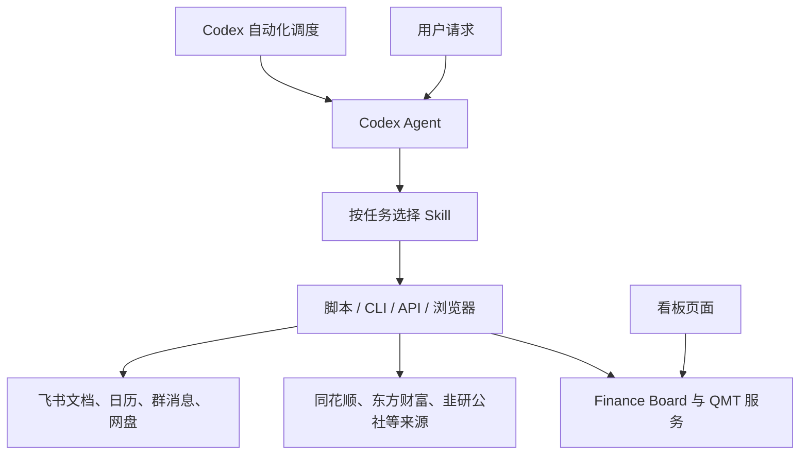

**Finance Board：Skill、开源组件与实际部署版本**

核对日期：2026-11-01。本文补充 [架构总览](../../docs/architecture/project-overview-2026-11-01.md)，依据本机 SKILL.md、自动化配置、代码调用、安装包元数据、历史部署验收文件与上游公开仓库。这里的“已安装”“任务要求使用”“代码调用”“曾验收通过”“当前链路可用”分别记录，不混作一个状态。

**Skill 在架构中的位置**

Skill 是供 Agent 读取的操作规程、知识索引和脚本入口。它规定任务如何取数、验证、生成产物和使用外部工具；真正执行的是脚本、CLI、API 或常驻服务。Skill 本身不负责定时唤醒。

看板页面与 Node/Python 服务主要直接运行代码。已核对的例子：连板天梯直接调用 `hithink-finance` CLI；消息推送程序直接调用 `lark-cli`；AI 页面以固定提示词和知识摘要调用隔离 Codex。后者明确关闭 Skill 搜索和宿主 Skill 自动发现，因此不会在每次分析时自动执行整套金融 Skills。

**主要 Skill 族与项目关系**

| Skill 族 | 用途 | 当前关系 |
| --- | --- | --- |
| [convertible-bond](/Users/seasnake/.codex/skills/convertible-bond/SKILL.md) | 可转债条款、估值、双低、三线复式、竞价、T+0、强赎、下修和复盘 | 按需研究知识；部分已核对摘要进入 AI 知识文件，运行时不自动读取整套资料 |
| `qmt-bridge-*`，本机共 23 个 | 行情、账户、复盘、风控、执行、日历、财务和运维 | Agent 的 QMT 工具族；多数面向官方 MiniQMT HTTP Bridge，并不自动继承看板网关的行情路由 |
| [qmt-intraday-indicator-charts](/Users/seasnake/.codex/skills/qmt-intraday-indicator-charts/SKILL.md) | 批量生成分时、紫线、MACD、明暗盘等静态 PNG | 独立的取数与导图工作流，指向仓库外的固定绘图项目 |
| [miniqmt-to-bigqmt](/Users/seasnake/.codex/skills/miniqmt-to-bigqmt/SKILL.md) | MiniQMT/xtquant 策略向大 QMT 内置 Python 转换 | 源码迁移规程；与日常服务诊断的 qmt-bridge-pd 分工不同 |
| [jiuyangongshe-pipeline](/Users/seasnake/.codex/skills/jiuyangongshe-pipeline/SKILL.md) | 指定作者文章发现、正文与图片采集、指纹去重、落盘和发布验收 | 盘前纪要、财闻私享、投资日历自动化明确要求读取 |
| [hithink-finance](/Users/seasnake/.codex/skills/hithink-finance/SKILL.md) 与 10 个业务子技能 | 同花顺行情、财报、估值、指数、基金、特色数据、目录及本地研究数据 | Agent 数据工具；连板天梯已直接使用其 CLI 的涨停池能力 |
| `mx-data / mx-search / mx-xuangu / mx-zixuan` | 东方财富妙想数据、资讯检索、选股、自选管理 | 按需数据能力；未发现主看板运行链统一经这些 Skill 调用的证据 |
| `lark-*` | 飞书身份、文档、文件夹、日历、消息和表格 | 自动报告与消息发送的外部交付工具族 |
| [baidu-drive](/Users/seasnake/.codex/skills/baidu-drive/SKILL.md)、[baidu-level2-picker](/Users/seasnake/.codex/skills/baidu-level2-picker/SKILL.md) | 网盘转存/核验，以及按证券代码和日期提取 Level2 文件 | 与金融数据归档有关；当前看板分钟与信号数据没有因此自动切换成 Level2 |
| `deep-analysis / equity-researcher / investor-panel / lhb-analyzer` | 个股深度研究、正式研报、多方法评审、龙虎榜 | 已安装的按需研究工具，未证实是当前看板或既有八项自动化的固定运行依赖 |
| [browser-harness](/Users/seasnake/.codex/skills/browser-harness/SKILL.md) | 操作已运行 Chrome、网页采集和页面验收 | 浏览器维护工具；不同于后台消息扩展，也不是行情服务器 |

东方财富“妙想”技能的 `mx-*` 名称，与之前采集小王子/快讯的 MX 聊天网站不是同一套接入。

**23 个 QMT Bridge Skill 的具体分工**

| Skill | 主要工作 |
| --- | --- |
| [qmt-bridge-pd](/Users/seasnake/.codex/skills/qmt-bridge-pd/SKILL.md) | Parallels VM、官方 Bridge、大 QMT 网关/策略连接诊断 |
| [qmt-bridge-market-watch](/Users/seasnake/.codex/skills/qmt-bridge-market-watch/SKILL.md) | 自选报价、指数环境和交易日检查 |
| [qmt-bridge-convertible](/Users/seasnake/.codex/skills/qmt-bridge-convertible/SKILL.md) | 转债列表、条款与转股资料 |
| [qmt-bridge-sector-theme](/Users/seasnake/.codex/skills/qmt-bridge-sector-theme/SKILL.md) | 板块成分、行业主题和涨跌排序 |
| [qmt-bridge-technical-signal](/Users/seasnake/.codex/skills/qmt-bridge-technical-signal/SKILL.md) | QMT 公式和指标信号检查 |
| [qmt-bridge-realtime-monitor](/Users/seasnake/.codex/skills/qmt-bridge-realtime-monitor/SKILL.md) | WebSocket 订阅与回报对账规程；不同于目前 HTTP 轮询的独立短线监控 |
| [qmt-bridge-event-calendar](/Users/seasnake/.codex/skills/qmt-bridge-event-calendar/SKILL.md) | 交易日、交易时段和事件检查 |
| [qmt-bridge-kline-backfill](/Users/seasnake/.codex/skills/qmt-bridge-kline-backfill/SKILL.md) | 当前重点是近 N 日两市成交额校验，默认使用 tick 与本地日缓存；不是看板的通用分钟补数队列 |
| [qmt-bridge-financial-download](/Users/seasnake/.codex/skills/qmt-bridge-financial-download/SKILL.md) | 将财务数据下载到服务端缓存 |
| [qmt-bridge-fundamental-screen](/Users/seasnake/.codex/skills/qmt-bridge-fundamental-screen/SKILL.md) | 基本面指标筛选、缺数补齐 |
| [qmt-bridge-etf](/Users/seasnake/.codex/skills/qmt-bridge-etf/SKILL.md) | ETF 资料、申赎清单和行情 |
| [qmt-bridge-option](/Users/seasnake/.codex/skills/qmt-bridge-option/SKILL.md) | 期权链和合约资料 |
| [qmt-bridge-hk-connect](/Users/seasnake/.codex/skills/qmt-bridge-hk-connect/SKILL.md) | 港股通标的与相关字典 |
| [qmt-bridge-trading](/Users/seasnake/.codex/skills/qmt-bridge-trading/SKILL.md) | 账户与持仓查询、订单预览及明确授权后的真实执行 |
| [qmt-bridge-order-ops](/Users/seasnake/.codex/skills/qmt-bridge-order-ops/SKILL.md) | 委托查询、可撤单与撤单 |
| [qmt-bridge-smart-execution](/Users/seasnake/.codex/skills/qmt-bridge-smart-execution/SKILL.md) | 价格类型、滑点与分批执行预览 |
| [qmt-bridge-rebalance](/Users/seasnake/.codex/skills/qmt-bridge-rebalance/SKILL.md) | 根据目标权重生成调仓清单及授权后的执行 |
| [qmt-bridge-credit-margin](/Users/seasnake/.codex/skills/qmt-bridge-credit-margin/SKILL.md) | 信用账户、保证金、担保品及相关操作 |
| [qmt-bridge-portfolio-risk](/Users/seasnake/.codex/skills/qmt-bridge-portfolio-risk/SKILL.md) | 集中度、仓位、现金和可卖量 |
| [qmt-bridge-daily-pnl](/Users/seasnake/.codex/skills/qmt-bridge-daily-pnl/SKILL.md) | 当日盈亏，包括已清仓标的 |
| [qmt-bridge-execution-review](/Users/seasnake/.codex/skills/qmt-bridge-execution-review/SKILL.md) | 委托成交、执行质量、交易复盘及不操作基线对比 |
| [qmt-bridge-return-analysis](/Users/seasnake/.codex/skills/qmt-bridge-return-analysis/SKILL.md) | 多周期涨跌、量价与观察条件 |
| [qmt-bridge-feishu-doc](/Users/seasnake/.codex/skills/qmt-bridge-feishu-doc/SKILL.md) | 将上述报告按规程发布到飞书，实际 IO 交给 lark-cli |

Skill 文件和脚本存在，不证明当前上游支持每个接口。部分文档仍含规划性步骤与旧端口示例；执行时需核对目标后端。WebSocket/L2 技能存在，也不证明目前的大 QMT 管道适配已支持全部这些能力。

**数据与研究工具的细分入口**

同花顺十个子技能：`hithink-finance-market`（行情/日历）、`financials`（财报）、`valuation`（当前估值）、`index`（指数/概念/行业）、`fund`（基金/ETF）、`special-data`（涨跌停/连板/龙虎榜等）、`symbol`（证券目录）、`data`（本地 DuckDB）、`research`（已有数据的研究准备）、`shared`（认证、配置和诊断）。这里后九项为省略共同前缀的写法。

东方财富四个入口：[mx-data](/Users/seasnake/.codex/skills/mx-data/SKILL.md)、[mx-search](/Users/seasnake/.codex/skills/mx-search/SKILL.md)、[mx-xuangu](/Users/seasnake/.codex/skills/mx-xuangu/SKILL.md)、[mx-zixuan](/Users/seasnake/.codex/skills/mx-zixuan/SKILL.md)。这些技能的可用性依赖各自账号与数据接口，本次未发出业务请求验证。

研究入口：[deep-analysis](/Users/seasnake/.agents/skills/deep-analysis/SKILL.md)、[equity-researcher](/Users/seasnake/.codex/skills/equity-researcher/SKILL.md)、[investor-panel](/Users/seasnake/.agents/skills/investor-panel/SKILL.md)、[lhb-analyzer](/Users/seasnake/.agents/skills/lhb-analyzer/SKILL.md)。按用户要求选择，不能因已安装就把所有研究工作都套入完整研报或评审流程。

**已有定时任务如何使用 Skill**

| 自动化 | 提示词明确指定的 Skill | 关系说明 |
| --- | --- | --- |
| 盘前纪要、财闻私享、财闻重查 | jiuyangongshe-pipeline、lark-doc、lark-drive | 阅读证据与生成报告；飞书公共规则由相应技能继续引用 |
| A 股投资日历 | jiuyangongshe-pipeline、lark-calendar | 全文/图片事件提取、日程去重与回读 |
| 公众号早报、晚报 | lark-im | RSS 来源由任务指定的容器提供；Skill 负责消息流程 |
| PD 检查 | qmt-bridge-pd | 只执行任务限定的 VM 检查/恢复范围 |
| Level2 转存 | 提示词直接调用 daily_level2.py，没有显式 Skill 名称 | baidu-drive 记录了同一脚本与 XPan 核验规程，不应说调度器每次自动读取了该 Skill |

飞书核心入口为 [lark-shared](/Users/seasnake/.agents/skills/lark-shared/SKILL.md)、[lark-doc](/Users/seasnake/.agents/skills/lark-doc/SKILL.md)、[lark-drive](/Users/seasnake/.agents/skills/lark-drive/SKILL.md)、[lark-calendar](/Users/seasnake/.agents/skills/lark-calendar/SKILL.md)、[lark-im](/Users/seasnake/.agents/skills/lark-im/SKILL.md)。电子表格与多维表格另有 lark-sheets/lark-base，不能因此视为当前日报流程固定依赖。

**“最新版”对应的三个版本面**

1. **实际部署与最近验收**：大 QMT 路线最近保留的部署验收为 `xtquant-big-convert 0.3.74` + 本项目单文件/管道/中继适配，2026-10-27 盘后验收通过，后续 10 月 28/30 日有监控恢复记录。11 月 1 日 Mac 安装包仍为 0.3.74；本次新报价检查失败，不能称整套系统当前健康。
2. **本地看板源码**：`codex/miniqmt-dashboard` 的 HEAD 是 `edfbfd9`，并有大量未提交功能与修复。因此仅凭这个提交号仍不能重建当前本机版本。
3. **远端与上游**：本次只读查询 GitHub 远端，finance-board `main` 仍为 `803b2bbcd1914c0a234b5e5a3df57e6efe53bbec`，所查询的同名开发分支没有返回远端引用。PyPI 的 xtquant-big-convert 最新发布号已是 **0.3.78（2026-10-28）**，不是当前安装/已验收版本。[PyPI 发布页](https://pypi.org/project/xtquant-big-convert/)

**直接接入或有部署证据的开源组件**

版本栏明确区分当前本机读取与 Windows 历史验收；没有对所有依赖执行升级或重新验收。

| 组件 | 核对版本/证据 | 在项目中的实际用途 |
| --- | --- | --- |
| [Node.js](https://github.com/nodejs/node) | 主服务配置使用 22.22.1 | HTTP 服务、API 聚合、前端静态文件、业务定时器；项目 package.json 没有声明 npm dependencies |
| [CPython](https://github.com/python/cpython) / SQLite | 看板与网关的 Miniconda Python 3.13.2；消息服务配置为系统 Python 3.9.6 | 数据服务、网关、监控、SQLite 与任务脚本；SQLite 主要通过标准库使用 |
| [xtquant_big_convert](https://github.com/litaolemo/xtquant_big_convert) | Mac 当前 0.3.74；Windows 10 月 27 日清单与 ping 同为 0.3.74 | 大 QMT 对外查询兼容、RPC、管道适配与协议封装，是当前大 QMT 接入核心 |
| [PyZMQ / ZeroMQ](https://github.com/zeromq/pyzmq) | Mac 当前 PyZMQ 26.2.0；Windows 验收为 PyZMQ 18.0.1、libzmq 4.3.1 | Mac 与 Windows 外部中继间的消息通信 |
| [QMT Bridge](https://github.com/atorber/qmt-bridge) 与 [QMT Trading Skill](https://github.com/atorber/qmt-trading-skill) | Mac 安装 qmt-bridge 2.9.0，editable 来源是旧 vendor 导入目录；Windows 当前版本本次未复核 | 官方 MiniQMT HTTP/WebSocket 服务生态、QMTClient 和 Agent Skills；仅保留兼容接口约定；MiniQMT 服务已停用，当前行情走大 QMT，账户与交易停用 |
| 同花顺 Financial-API / hithink-finance-cli | 本机 CLI 0.1.5；安装包标明 MIT | 连板天梯直接调用完整分页涨停池；安装包 [元数据](/Users/seasnake/.nvm/versions/node/v22.22.1/lib/node_modules/@hithink-tech/hithink-finance-cli/package.json) 指向 HiThink-Tech/Financial-API，但该仓库公开地址本次返回 404 |
| [larksuite/cli](https://github.com/larksuite/cli) | `lark-cli --version` 为 1.0.92 | 飞书文档、日期目录、日历、群消息与图片交付 |
| [stock_trading_lab_open_source](https://github.com/jinrujiezoulema/stock_trading_lab_open_source) 的本地改造 | 本地仓库基线 8e1a3f8；调度配置明确指向其作者管道脚本 | 韭研公社正文、图片、指纹和证据采集；只复用相关管道，不是把整个交易平台作为看板后端 |
| [Requests](https://github.com/psf/requests) / [Beautiful Soup](https://www.crummy.com/software/BeautifulSoup/) | 研究任务所用 Miniconda 环境为 2.32.3 / 4.15.0 | 上述作者管道实际 import 的 HTTP 请求与 HTML 解析组件 |
| [Pillow](https://github.com/python-pillow/Pillow) | 消息服务的系统 Python 环境为 11.3.0 | 图片解码、EXIF 方向校正、像素签名去重；对应消息服务当前停用 |

大 QMT 配套部署不是直接使用原包默认配置：项目把策略打成单文件、关闭 Redis 和 native xtdata socket、走 Windows 本机命名管道，并由外部进程持有 ZMQ 网络端口。构建脚本还补入了 QMT 注入函数捕获逻辑。文档出现 `redis_rpc` 模块名，不表示当前部署启用了 Redis 服务。

当前安装包只把 PyZMQ 作为默认依赖，Redis/MySQL/msgpack 属于可选扩展；不能将上游支持的所有传输后端写成线上都在运行。

上游 README 当前明确声明项目停止更新，并称其相关远程传输方案受到券商限制。这是维护者对上游状态的说明，本次没有据此推断用户账户权限或本机超时的原因。当前部署版本与未来升级可用性需分别验收。[上游当前说明](https://github.com/litaolemo/xtquant_big_convert)

**外围任务与按需工具的组件**

| 组件 | 实际关系与证据边界 |
| --- | --- |
| [WeWe RSS](https://github.com/cooderl/wewe-rss) | 旧公众号早晚报配置指定 `convertible-bond-wewe` 容器和 4000 RSS 端点。本次 Docker 连接失败，未取得镜像版本；不能称当前运行。上游仓库已归档 |
| [BaiduPCS-Rust](https://github.com/komorebiCarry/BaiduPCS-Rust) | 本地保留 v2.2.2 分发目录与 README；Level2 日档脚本调用本机网盘服务，并以 XPan 独立校验。此轮未验证登录或转存 |
| 7-Zip / 7zz 与本地 l2pick 工具 | 按代码和日期读取压缩包成员/压缩块并提取逐笔文件；不是网页盘中热路径 |
| AKShare、NumPy、pandas、Matplotlib | Miniconda 当前可见版本分别为 1.18.64、2.5.4、2.3.3、3.10.7；用于生态研究、日历或导图工具，不能只因已安装就把它们全算作 Node/数据 API 的直接依赖 |
| Codex CLI | AI 报告与 Agent 自动任务的执行引擎；具体应用内版本此轮未单独建立版本清单；模型服务、登录与开源 CLI 是不同依赖 |
| browser-harness | 本机 editable 的 Chrome CDP 工具，用于浏览器采集/验收；当前源目录由本机 AGENTS 指定，未在本轮执行浏览器任务 |

微信 RSS 工作目录还残留另一套 we-mp-rss 源码/compose，不能因目录存在就把它替换为旧任务实际引用的 WeWe RSS。类似地，外部来源接口或账号服务不是“开源库”：QMT 券商终端、通达信客户端/TQ、飞书云端、同花顺/东方财富数据、Parallels 与模型服务应作为外部系统单独记录。

**只作参考、没有证据表明整套运行接入的项目**

| 项目 | 本项目借鉴内容 |
| --- | --- |
| Tick Stock Panel | AI 分析的数据准备、固定提示词、任务和历史报告流程；本项目有自己的实现，不依赖其服务 |
| EasyXT | 适配器与组合策略规则思路；组合引擎为独立复现，不能当作已导入其整个框架 |
| course_ai_quant_system_w12 | 策略注册、生命周期和业务分层的路线图参考 |
| web3-quant-sandbox | 分层、研究时点与验证治理参考 |
| ZVT | 数据 Schema、Provider 与查询接口思路 |
| TradingAgents、Qbot | 研究提案或策略素材，未作为当前实时数据/订单执行主干 |

**本地验收依据**

- [固定版本与部署准备脚本](../../scripts/prepare_bigqmt_rpc_bundle.py)
- [单文件管道适配脚本](../../scripts/prepare_bigqmt_pipe_bundle.py)
- [10 月 27 日部署汇总](../../runtime/qmt-migration/upgrade-20261027/result.json)
- [Windows 管道与中继验收](../../runtime/qmt-migration/upgrade-20261027/windows-pipe-result.json)
- [当前连板数据源调用](../../lib/limit-ladder-sources.js)
- [当前 AI 进程隔离配置](../../lib/codex-text-provider.js)
- [韭研公社任务的实际管道配置](/Users/seasnake/.local/share/jiuyangongshe-finance/config.json)
- [仅供设计参考的模块化路线图](../../docs/architecture/2026-08-modularization-roadmap.md)
